# RESULTS (auto-generated)

Generated 2026-10-23 22:12 by `scripts/make_report.py` from `results/*/runs.csv`; code hash `9ae5c371db290ba7`. **Do not edit by hand** — re-run the script.

> **Verification status.** FIFO, SP and DRR are textbook. RL-SP+DRR (arXiv:2002.07027, Algorithm 1) and CQDRR (Electronics Letters e70418, Eqs. 1-13) were re-implemented from their full texts; where those papers are silent, our choices are listed in `docs/ALGORITHM_SPEC.md`. FuzzyDRR and RevenueDRR are *inspired-by* designs: their full texts could not be obtained, and only the abstract (FuzzyDRR) or a 2-page preview (RevenueDRR) was checked; FuzzyDRR has a known input mismatch. The optional ninth scheduler SCRR (NSDI 2025) follows its paper's Algorithms 3-4. DR-DRR (delay-risk DRR) is **our own design**: the plan's source for it could not be found, so it is not attributed. See `docs/REFERENCES_CHECK.md`.

- Reported runs in the main matrix E1–E8: **6520** (seeds 101–120); further arms (E9, E9C, E10, E1D, E1V, ES) are reported in their own sections. Failed runs: **none**.
- Pairing verified: 2320 (point, seed) groups, each with a single trace digest across all 8 schedulers.
- Tuned parameters (dev seeds 1–5, frozen before reported runs): `{'RL-SP+DRR': {'rate_frac': 0.4}, 'DR-DRR': {'kappa': 4.0}, 'CQDRR': {'scale': 93.75}, 'FuzzyDRR': {'gain': 0.1}, 'RevenueDRR': {'tau': 0.0125}}`.
- Values are mean ± 95 % t-interval half-width over 20 seeds; delays in ms. `W = max_i p95_i / D_i` with D = (10, 50, 500) ms: W ≤ 1 means every class met its p95 target.

## Headline results (computed)

1. **Strict Priority** gives the lowest latency-class p95 at 14/14 E1 points, but starves other classes under overload.
2. **Starvation** (> 100 ms backlogged without service), episodes summed over E1–E8 (longest single gap): FIFO 1142 (288 ms), SP 21286 (2389 ms), CQDRR 12666 (444 ms); every other scheduler 0. FIFO has no priorities: its episodes are head-of-line waits in one long FIFO queue (mostly E4's 500 kB buffer), not service denial.
3. **No single best adaptive scheduler**: best non-SP on W — DR-DRR 14/29, CQDRR 5/29, RL-SP+DRR 4/29, RevenueDRR 4/29, FuzzyDRR 2/29.
4. **Shared tail-drop buffer fixes throughput shares**: Jain's index >= 0.9981 for every scheduler and run in E1 ON/OFF; fairness differences appear only with a partitioned buffer (E8).
5. **Weight oscillation** helps under bursts and hurts under smooth overload (E9 + control E9C); damping (lambda = 0.5) lowers W by up to 51%.
6. **Paper-trend checks**: RL-SP+DRR reproduced; CQDRR not reproduced (4/8); SCRR latency reproduced (8/8), fairness reproduced.
7. **Real-life stress (E11, 8 scenarios)**: SP still gives the lowest latency in all 8; DR-DRR beats DRR in all 8 and is the most robust non-SP scheduler; a non-work-conserving shaper (RL-SP+DRR) behind a shared buffer lets one mislabelled class waste link capacity and raise everyone's loss (section E11).
8. **More conditions (E12: IMIX sizes, RED queue management, bulk flood, shallow buffer + jumbo)**: SP lowest latency 4/4, no DRR-family starvation 4/4, DR-DRR beats DRR 4/4. Method checks: 100 seeds agree with the 20-seed intervals (8/8); a 10x longer window changes no mean W by more than 6 % (one statistical tie swaps places).
9. **Published examples (E13)**: 14/16 pre-registered comparisons pass. The DRR trajectory delay of Tabatabaee & Le Boudec (119.256 µs) is reproduced exactly; Bouillard's bounds hold and are 83.8%–99.8% tight; the original DRR and RL-SP-DRR shares are reproduced; SCRR as printed exceeds its own Theorems 1–2 because of the order of two steps in Algorithm 4.
10. **DR-DRR ablation (E14)**: against the backlog-only variant the verdict is 'the full rule adds value' (9 better / 0 worse of 14), against the head-of-line-only variant 'mixed' (4 / 6).
11. **Held-out seeds (E15)**: SP lowest latency 14/14; same best non-SP scheduler 14/14; held-out means inside the original intervals for FIFO 13/14, SP 11/14, DRR 14/14, RL-SP+DRR 12/14, DR-DRR 14/14, CQDRR 9/14, FuzzyDRR 14/14, RevenueDRR 12/14.
12. **Real Linux kernel (E16)**: kernel and simulator order FIFO, SP and DRR identically at 3/3 points; mean delays agree within the registered tolerance in 18/27 cells (the kernel's virtual-machine timer stalls lower its rate to 9.64-9.95 Mb/s).
13. **Real backbone traffic (E17, MAWI)**: SP lowest latency 3/3 loads; DR-DRR beats DRR 3/3; no DRR-family starvation 3/3; the best non-SP scheduler is CQDRR (on synthetic traffic it is usually DR-DRR).
14. **Score check (E18)**: DR-DRR is the most frequent best non-SP scheduler under 2 of 4 scores that do not use our targets -> partly an artefact of W (winners: W DR-DRR, S1 RevenueDRR, S2 DR-DRR, S3a DR-DRR, S3b FIFO).
15. **Tuned static DRR (E19)**: quanta [6000.0, 6000.0, 1500.0]; DR-DRR better at 6/14 points, worse at 8/14 -> mixed.
16. **Kernel at 1 Mb/s (E16b)**: kernel waiting times match the simulator's prediction within the registered tolerance in 26/27 cells (18/27 at 10 Mb/s) and the scheduler order matches at 3/3 points.
17. **Class-mapping sensitivity (E17b)**: with two alternative mappings (strict ports; packet size), SP is still lowest at every load and DR-DRR still beats DRR: robust.
18. **Static DRR on fresh seeds (E19H)**: DR-DRR better at 6/14, worse at 8/14 -> mixed (E19 on the reporting seeds: 6 and 8).
19. **Second backbone trace (E17c)**: SP lowest latency 3/3 loads; DR-DRR beats DRR 0/3; no other starvation 3/3; best non-SP: DR-DRR, FuzzyDRR.

## RQ1 — Latency-class p95 under identical traffic (E1)

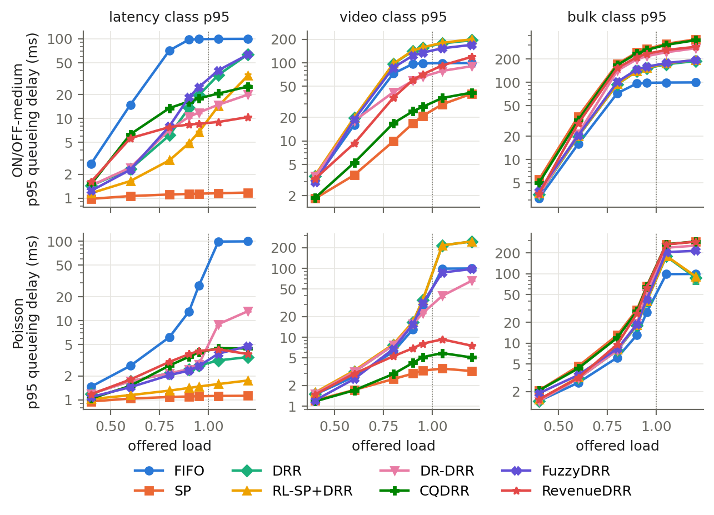

**onoff, load 0.95**

| scheduler | lat p95 | lat p99 | vid p95 | blk p95 | W |
|---|---|---|---|---|---|
| FIFO | 99.1 ± 0.1 | 99.9 ± 0.0 | 98.5 ± 0.1 | 98.1 ± 0.1 | 9.908 ± 0.007 |
| SP | 1.1 ± 0.0 | 1.3 ± 0.0 | 20.9 ± 0.7 | 267.5 ± 7.0 | 0.535 ± 0.014 |
| DRR | 19.6 ± 1.0 | 31.5 ± 2.5 | 156.3 ± 4.2 | 151.1 ± 5.3 | 3.126 ± 0.084 |
| RL-SP+DRR | 6.8 ± 0.2 | 10.2 ± 0.6 | 158.0 ± 4.2 | 153.1 ± 5.5 | 3.159 ± 0.083 |
| DR-DRR | 11.9 ± 0.3 | 16.4 ± 0.4 | 66.3 ± 1.4 | 216.8 ± 4.1 | 1.326 ± 0.028 |
| CQDRR | 17.8 ± 0.4 | 27.1 ± 0.8 | 27.3 ± 0.7 | 260.2 ± 6.9 | 1.784 ± 0.038 |
| FuzzyDRR | 24.7 ± 1.1 | 37.8 ± 2.5 | 135.1 ± 3.1 | 158.0 ± 4.0 | 2.726 ± 0.069 |
| RevenueDRR | 8.6 ± 0.1 | 10.5 ± 0.1 | 71.2 ± 2.3 | 232.5 ± 4.6 | 1.425 ± 0.045 |

**onoff, load 1.2**

| scheduler | lat p95 | lat p99 | vid p95 | blk p95 | W |
|---|---|---|---|---|---|
| FIFO | 99.8 ± 0.0 | 100.3 ± 0.0 | 99.4 ± 0.0 | 99.2 ± 0.0 | 9.985 ± 0.001 |
| SP | 1.2 ± 0.0 | 1.4 ± 0.0 | 40.2 ± 1.8 | 356.8 ± 5.3 | 0.812 ± 0.029 |
| DRR | 63.5 ± 3.8 | 97.7 ± 8.1 | 194.5 ± 2.7 | 187.3 ± 3.0 | 6.351 ± 0.383 |
| RL-SP+DRR | 34.4 ± 2.0 | 52.4 ± 3.7 | 199.8 ± 3.0 | 193.5 ± 3.4 | 4.054 ± 0.108 |
| DR-DRR | 19.9 ± 0.3 | 26.5 ± 0.7 | 90.5 ± 1.5 | 273.9 ± 3.9 | 1.990 ± 0.028 |
| CQDRR | 25.1 ± 1.0 | 46.2 ± 3.7 | 41.5 ± 0.7 | 348.1 ± 5.8 | 2.512 ± 0.098 |
| FuzzyDRR | 63.2 ± 2.5 | 85.6 ± 3.9 | 169.9 ± 2.3 | 192.7 ± 2.6 | 6.322 ± 0.251 |
| RevenueDRR | 10.4 ± 0.1 | 13.1 ± 0.3 | 119.3 ± 4.7 | 285.9 ± 5.0 | 2.386 ± 0.094 |

**poisson, load 0.95**

| scheduler | lat p95 | lat p99 | vid p95 | blk p95 | W |
|---|---|---|---|---|---|
| FIFO | 27.5 ± 2.1 | 43.5 ± 6.5 | 27.5 ± 2.2 | 27.6 ± 2.3 | 2.751 ± 0.211 |
| SP | 1.1 ± 0.0 | 1.2 ± 0.0 | 3.3 ± 0.0 | 65.9 ± 5.4 | 0.132 ± 0.010 |
| DRR | 2.7 ± 0.0 | 3.4 ± 0.0 | 34.5 ± 2.8 | 40.0 ± 3.1 | 0.689 ± 0.057 |
| RL-SP+DRR | 1.5 ± 0.0 | 2.0 ± 0.0 | 34.8 ± 2.9 | 40.3 ± 3.1 | 0.697 ± 0.058 |
| DR-DRR | 2.8 ± 0.0 | 3.6 ± 0.1 | 22.4 ± 0.3 | 51.7 ± 5.6 | 0.447 ± 0.006 |
| CQDRR | 4.0 ± 0.0 | 5.7 ± 0.1 | 5.1 ± 0.1 | 64.6 ± 5.4 | 0.397 ± 0.004 |
| FuzzyDRR | 2.7 ± 0.0 | 3.4 ± 0.0 | 31.3 ± 1.8 | 42.2 ± 4.0 | 0.627 ± 0.036 |
| RevenueDRR | 4.1 ± 0.0 | 5.5 ± 0.0 | 8.1 ± 0.1 | 62.6 ± 5.4 | 0.415 ± 0.002 |

Paired difference in latency-class p95 vs DRR (negative = better), ON/OFF-medium:

| load | FIFO | SP | RL-SP+DRR | DR-DRR | CQDRR | FuzzyDRR | RevenueDRR |
|---|---|---|---|---|---|---|---|
| 0.4 | +1.3 (p<.001) | -0.5 (p<.001) | -0.3 (p<.001) | -0.0 (p=0.32) | +0.1 (p<.001) | -0.2 (p<.001) | +0.2 (p<.001) |
| 0.8 | +65.4 (p<.001) | -5.0 (p<.001) | -3.2 (p<.001) | +1.0 (p<.001) | +7.3 (p<.001) | +1.9 (p<.001) | +1.6 (p<.001) |
| 0.95 | +79.5 (p<.001) | -18.5 (p<.001) | -12.9 (p<.001) | -7.7 (p<.001) | -1.8 (p=0.001) | +5.1 (p<.001) | -11.0 (p<.001) |
| 1.2 | +36.3 (p<.001) | -62.3 (p<.001) | -29.1 (p<.001) | -43.6 (p<.001) | -38.4 (p<.001) | -0.3 (p=0.9) | -53.1 (p<.001) |

Facts:
- Lowest latency-class p95: SP at 14/14 E1 points (a static baseline wins RQ1 outright).
- Excluding SP, lowest latency p95 at E1 points: RL-SP+DRR 12, RevenueDRR 2.

## RQ2 — Cost to other classes: delay, starvation, throughput, fairness (E5, E8)

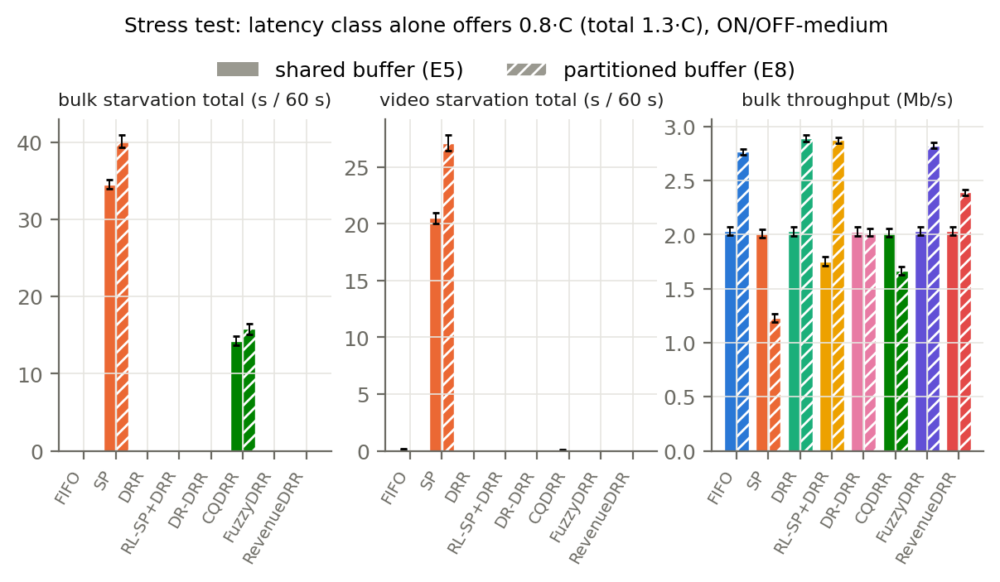

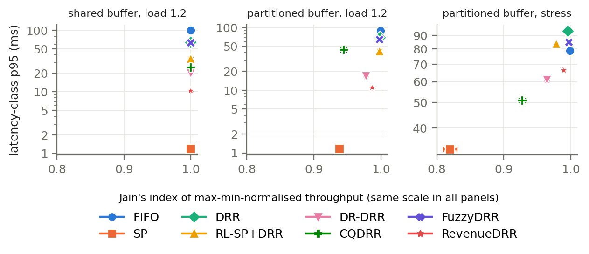

**E5 stress, shared buffer** (latency class alone offers 0.8·C; total 1.3·C):

| scheduler | lat p95 | vid p95 | blk p95 | blk starv # | blk starv s | vid starv s | blk tput Mb/s | Jain |
|---|---|---|---|---|---|---|---|---|
| FIFO | 100.0 ± 0.0 | 98.5 ± 0.1 | 98.1 ± 0.1 | 0.00 ± 0.00 | 0.00 ± 0.00 | 0.13 ± 0.04 | 2.03 ± 0.04 | 0.912 ± 0.007 |
| SP | 46.0 ± 1.3 | 258.4 ± 10.4 | 639.0 ± 15.5 | 140.40 ± 3.92 | 34.53 ± 0.59 | 20.51 ± 0.50 | 2.01 ± 0.04 | 0.906 ± 0.007 |
| DRR | 176.3 ± 1.9 | 26.6 ± 1.1 | 62.4 ± 2.7 | 0.00 ± 0.00 | 0.00 ± 0.00 | 0.00 ± 0.00 | 2.03 ± 0.04 | 0.910 ± 0.007 |
| RL-SP+DRR | 250.6 ± 0.0 | 33.7 ± 1.4 | 66.6 ± 3.0 | 0.00 ± 0.00 | 0.00 ± 0.00 | 0.00 ± 0.00 | 1.75 ± 0.04 | 0.979 ± 0.003 |
| DR-DRR | 109.9 ± 0.6 | 50.3 ± 0.8 | 301.0 ± 4.3 | 0.00 ± 0.00 | 0.00 ± 0.00 | 0.00 ± 0.00 | 2.03 ± 0.04 | 0.911 ± 0.007 |
| CQDRR | 76.3 ± 1.5 | 66.5 ± 2.3 | 573.2 ± 14.3 | 87.40 ± 3.51 | 14.26 ± 0.55 | 0.08 ± 0.04 | 2.02 ± 0.04 | 0.908 ± 0.007 |
| FuzzyDRR | 166.9 ± 1.3 | 36.2 ± 1.4 | 83.7 ± 3.4 | 0.00 ± 0.00 | 0.00 ± 0.00 | 0.00 ± 0.00 | 2.03 ± 0.04 | 0.911 ± 0.007 |
| RevenueDRR | 139.0 ± 0.8 | 44.9 ± 1.9 | 212.5 ± 5.1 | 0.00 ± 0.00 | 0.00 ± 0.00 | 0.00 ± 0.00 | 2.03 ± 0.04 | 0.912 ± 0.007 |

**E8 stress, partitioned buffer** (B/3 per class):

| scheduler | lat p95 | vid p95 | blk p95 | blk starv # | blk starv s | vid starv s | blk tput Mb/s | Jain |
|---|---|---|---|---|---|---|---|---|
| FIFO | 78.8 ± 0.8 | 83.4 ± 0.7 | 81.1 ± 0.8 | 0.00 ± 0.00 | 0.00 ± 0.00 | 0.00 ± 0.00 | 2.77 ± 0.03 | 0.999 ± 0.000 |
| SP | 33.3 ± 0.0 | 362.4 ± 11.7 | 749.6 ± 34.9 | 123.65 ± 3.90 | 40.16 ± 0.78 | 27.13 ± 0.71 | 1.23 ± 0.04 | 0.820 ± 0.010 |
| DRR | 93.4 ± 0.7 | 43.5 ± 3.0 | 79.0 ± 1.1 | 0.00 ± 0.00 | 0.00 ± 0.00 | 0.00 ± 0.00 | 2.89 ± 0.03 | 0.996 ± 0.001 |
| RL-SP+DRR | 83.7 ± 0.0 | 58.6 ± 3.8 | 86.3 ± 1.8 | 0.00 ± 0.00 | 0.00 ± 0.00 | 0.00 ± 0.00 | 2.87 ± 0.03 | 0.978 ± 0.001 |
| DR-DRR | 61.0 ± 0.5 | 54.4 ± 1.4 | 244.0 ± 3.2 | 0.00 ± 0.00 | 0.00 ± 0.00 | 0.00 ± 0.00 | 2.02 ± 0.03 | 0.965 ± 0.003 |
| CQDRR | 50.8 ± 0.3 | 48.1 ± 0.9 | 430.0 ± 14.3 | 102.30 ± 5.05 | 15.81 ± 0.70 | 0.00 ± 0.00 | 1.67 ± 0.04 | 0.928 ± 0.005 |
| FuzzyDRR | 84.8 ± 0.3 | 55.8 ± 2.9 | 89.7 ± 1.1 | 0.00 ± 0.00 | 0.00 ± 0.00 | 0.00 ± 0.00 | 2.83 ± 0.03 | 0.997 ± 0.000 |
| RevenueDRR | 66.3 ± 0.1 | 68.3 ± 2.7 | 150.9 ± 1.0 | 0.00 ± 0.00 | 0.00 ± 0.00 | 0.00 ± 0.00 | 2.39 ± 0.03 | 0.990 ± 0.001 |

**E8 load 1.2, partitioned buffer:**

| scheduler | lat p95 | vid p95 | blk p95 | lat tput Mb/s | vid tput Mb/s | blk tput Mb/s | Jain |
|---|---|---|---|---|---|---|---|
| FIFO | 89.4 ± 0.5 | 86.0 ± 0.5 | 85.5 ± 0.6 | 2.34 ± 0.03 | 3.57 ± 0.03 | 3.57 ± 0.03 | 1.000 ± 0.000 |
| SP | 1.2 ± 0.0 | 51.8 ± 0.6 | 334.2 ± 12.0 | 2.41 ± 0.03 | 4.53 ± 0.05 | 2.34 ± 0.05 | 0.938 ± 0.004 |
| DRR | 69.1 ± 2.0 | 96.5 ± 0.1 | 95.0 ± 0.2 | 2.40 ± 0.03 | 3.49 ± 0.03 | 3.52 ± 0.03 | 0.999 ± 0.000 |
| RL-SP+DRR | 41.7 ± 2.4 | 103.0 ± 0.6 | 101.0 ± 0.8 | 2.41 ± 0.03 | 3.47 ± 0.03 | 3.49 ± 0.03 | 0.998 ± 0.000 |
| DR-DRR | 16.5 ± 0.2 | 66.3 ± 0.4 | 187.7 ± 3.0 | 2.41 ± 0.03 | 4.11 ± 0.04 | 2.85 ± 0.04 | 0.978 ± 0.002 |
| CQDRR | 44.0 ± 1.1 | 45.9 ± 0.2 | 306.7 ± 10.0 | 2.41 ± 0.03 | 4.52 ± 0.05 | 2.43 ± 0.05 | 0.944 ± 0.004 |
| FuzzyDRR | 64.4 ± 1.6 | 90.3 ± 0.2 | 99.8 ± 0.4 | 2.41 ± 0.03 | 3.56 ± 0.03 | 3.46 ± 0.03 | 0.998 ± 0.000 |
| RevenueDRR | 11.1 ± 0.1 | 85.1 ± 1.0 | 142.7 ± 0.6 | 2.41 ± 0.03 | 3.94 ± 0.04 | 3.01 ± 0.03 | 0.987 ± 0.001 |

Facts:
- Shared buffer: Jain's index over all E1 ON/OFF runs ranges 0.9981–1.0000 across **all** schedulers; per-class drop rates at load 1.2 differ across schedulers by at most 0.98 percentage points. With a class-blind tail-drop buffer, admitted (hence delivered) traffic is proportional to arrivals, so the scheduler cannot change throughput shares — only delay.
- SP starves bulk 34.5 s and video 20.5 s per 60 s in E5. Starvation episodes (> 100 ms backlogged without service, any class) summed over all E1–E8 runs: FIFO 1142, SP 21286, DRR 0, RL-SP+DRR 0, DR-DRR 0, CQDRR 12666, FuzzyDRR 0, RevenueDRR 0.
- With a partitioned buffer the throughput cost becomes visible: in E8 stress, bulk throughput is FIFO 2.77, SP 1.23, DRR 2.89, RL-SP+DRR 2.87, DR-DRR 2.02, CQDRR 1.67, FuzzyDRR 2.83, RevenueDRR 2.39 Mb/s.

## RQ3 — Weight oscillation and its effect on tail delay

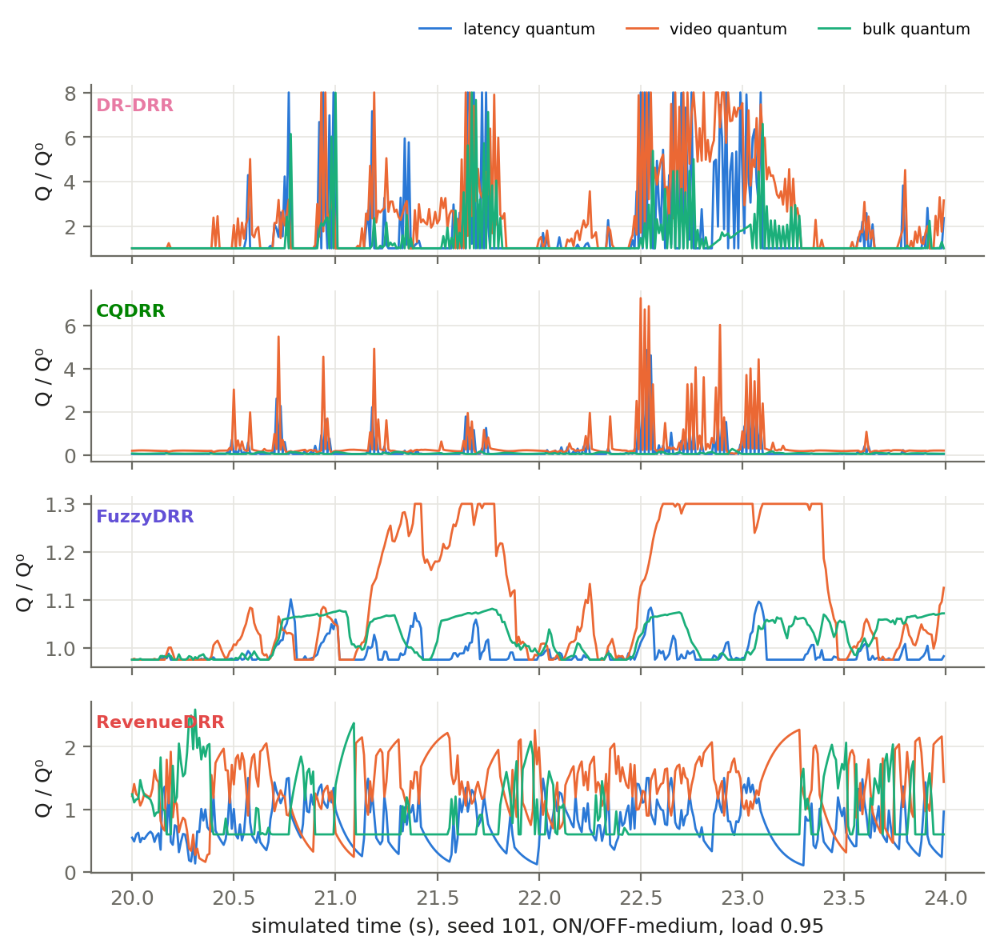

Oscillation (E1 ON/OFF, load 0.95): mean |ΔQ|/Q⁰ per 10-ms update and quantum sign flips per second.

| scheduler | |ΔQ|/Q⁰ per update | flips/s | lat-class |ΔQ|/Q⁰ |
|---|---|---|---|
| DR-DRR | 0.857 ± 0.036 | 32.6 ± 1.0 | 1.084 ± 0.042 |
| CQDRR | 0.285 ± 0.013 | 37.8 ± 0.7 | 0.279 ± 0.010 |
| FuzzyDRR | 0.007 ± 0.000 | 26.3 ± 0.2 | 0.006 ± 0.000 |
| RevenueDRR | 0.180 ± 0.002 | 36.7 ± 0.3 | 0.169 ± 0.002 |

Within-point Spearman correlation between oscillation and W across the 20 seeds (mean over E1 points):

- DR-DRR: ρ = +0.52 over 12 points
- CQDRR: ρ = +0.32 over 14 points
- FuzzyDRR: ρ = +0.33 over 14 points
- RevenueDRR: ρ = +0.19 over 14 points

A correlation across seeds cannot show cause; the intervention test is the pre-registered damping ablation E9 below.

### E9 — pre-registered DR-DRR damping ablation (+ post-hoc control E9C)

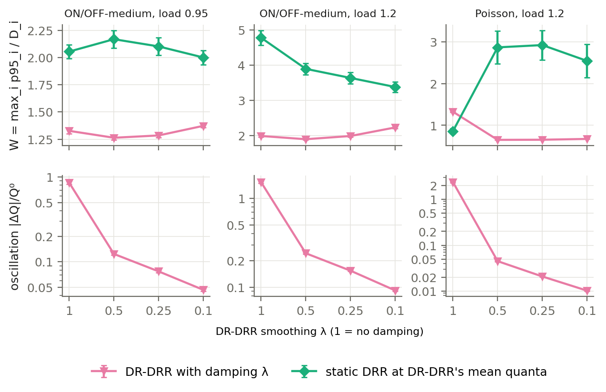

Rule (fixed before running, see protocol §E9): *supported* if at ≥ 2 of 3 points some λ < 1 lowers mean W by ≥ 5 % vs λ = 1 with Holm-corrected paired Wilcoxon p < 0.05; *not supported* if no λ < 1 lowers W significantly anywhere; otherwise *mixed*. E9C = static DRR fixed at DR-DRR's mean quanta for that (point, λ).

| point | λ | |ΔQ|/Q⁰ | W DR-DRR | ΔW vs λ=1 | Holm p | W static DRR @ mean Q (E9C) | DR-DRR − static (paired p) |
|---|---|---|---|---|---|---|---|
| onoff 0.95 | 1 | 0.857 | 1.326 ± 0.028 | – | – | 2.054 ± 0.064 | -0.728 (p=1.9e-06) |
| onoff 0.95 | 0.5 | 0.124 | 1.263 ± 0.021 | -4.8% | 5.7e-06 | 2.168 ± 0.082 | -0.905 (p=1.9e-06) |
| onoff 0.95 | 0.25 | 0.077 | 1.284 ± 0.020 | -3.2% | 1.9e-05 | 2.101 ± 0.079 | -0.817 (p=1.9e-06) |
| onoff 0.95 | 0.1 | 0.047 | 1.373 ± 0.017 | +3.5% | 0.00039 | 2.000 ± 0.065 | -0.627 (p=1.9e-06) |
| onoff 1.2 | 1 | 1.527 | 1.990 ± 0.028 | – | – | 4.778 ± 0.211 | -2.789 (p=1.9e-06) |
| onoff 1.2 | 0.5 | 0.242 | 1.897 ± 0.024 | -4.6% | 3.8e-05 | 3.895 ± 0.162 | -1.997 (p=1.9e-06) |
| onoff 1.2 | 0.25 | 0.154 | 1.989 ± 0.022 | -0.0% | 0.67 | 3.637 ± 0.159 | -1.648 (p=1.9e-06) |
| onoff 1.2 | 0.1 | 0.092 | 2.232 ± 0.032 | +12.2% | 5.7e-06 | 3.380 ± 0.144 | -1.148 (p=1.9e-06) |
| poisson 1.2 | 1 | 2.387 | 1.326 ± 0.014 | – | – | 0.859 ± 0.063 | +0.467 (p=1.9e-06) |
| poisson 1.2 | 0.5 | 0.045 | 0.652 ± 0.005 | -50.8% | 5.7e-06 | 2.866 ± 0.390 | -2.214 (p=1.9e-06) |
| poisson 1.2 | 0.25 | 0.021 | 0.655 ± 0.004 | -50.6% | 5.7e-06 | 2.921 ± 0.354 | -2.266 (p=1.9e-06) |
| poisson 1.2 | 0.1 | 0.010 | 0.674 ± 0.003 | -49.1% | 5.7e-06 | 2.542 ± 0.395 | -1.868 (p=1.9e-06) |

**Pre-registered verdict: mixed** — the ≥ 5 % criterion is met at 1 of 3 points.

Facts:
- Manipulation check: oscillation falls monotonically with λ at every point (table above).
- ON/OFF bursts: DR-DRR beats static DRR at its own mean quanta at every λ, so the weight movement is the adaptation that helps, not harmful noise; mild damping changes W by < 5 %, heavy damping (λ = 0.1) makes it worse.
- Poisson overload: static DRR at DR-DRR's λ = 1 mean quanta beats DR-DRR λ = 1 — here the oscillation itself costs tail delay, and damping (λ ≤ 0.5) roughly halves W.
- λ = 0.5 lowered W at all three points. It is a candidate for the plan's optional fix, but it was chosen on reported seeds; adopting it requires confirming on dev seeds and the other E1 points first.

### E1D — DR-DRR+damping (λ = 0.5) as a separate variant

Dev-seed confirmation (seeds 1–5, rule fixed beforehand, protocol §E1D): **confirmed** — worst point onoff|0.8 at +4.6 % W (limit +5 %), lower W at 6/8 points with load ≥ 0.9.

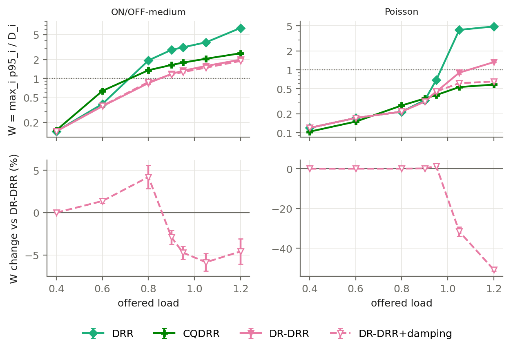

| point | W DR-DRR | W +damping | ΔW | Holm p | seeds better | lat p95 | vid p95 | blk p95 | |ΔQ|/Q⁰ | rank among 9 (8 + variant) |
|---|---|---|---|---|---|---|---|---|---|---|
| onoff 0.4 | 0.144 | 0.144 | +0.0% | 0.95 | 0/20 | 1.4→1.4 | 3.5→3.5 | 4→4 | 0.000→0.000 | 5 |
| poisson 0.4 | 0.119 | 0.119 | +0.0% | 1 | 0/20 | 1.2→1.2 | 1.5→1.5 | 1→1 | 0.000→0.000 | 6 |
| onoff 0.6 | 0.361 | 0.366 | +1.4% | 2.7e-05 | 0/20 | 2.4→2.4 | 18.0→18.3 | 21→21 | 0.007→0.002 | 3 |
| poisson 0.6 | 0.172 | 0.172 | +0.0% | 1 | 0/20 | 1.7→1.7 | 3.1→3.1 | 3→3 | 0.000→0.000 | 5 |
| onoff 0.8 | 0.843 | 0.878 | +4.1% | 0.00016 | 1/20 | 7.2→7.0 | 42.2→43.9 | 141→141 | 0.279→0.045 | 4 |
| poisson 0.8 | 0.216 | 0.217 | +0.0% | 0.63 | 6/20 | 2.2→2.2 | 7.7→7.7 | 8→8 | 0.000→0.000 | 6 |
| onoff 0.9 | 1.181 | 1.146 | -2.9% | 7.6e-05 | 19/20 | 10.5→9.9 | 59.0→57.3 | 197→202 | 0.660→0.096 | 2 |
| poisson 0.9 | 0.311 | 0.312 | +0.1% | 0.35 | 5/20 | 2.4→2.4 | 15.6→15.6 | 19→19 | 0.003→0.001 | 4 |
| onoff 0.95 | 1.326 | 1.263 | -4.8% | 2.7e-05 | 20/20 | 11.9→11.4 | 66.3→63.2 | 217→222 | 0.857→0.124 | 2 |
| poisson 0.95 | 0.447 | 0.453 | +1.3% | 2.7e-05 | 0/20 | 2.8→2.8 | 22.4→22.7 | 52→52 | 0.015→0.005 | 5 |
| onoff 1.05 | 1.577 | 1.484 | -5.9% | 2.7e-05 | 20/20 | 14.9→14.7 | 78.9→73.3 | 243→253 | 1.192→0.178 | 2 |
| poisson 1.05 | 0.901 | 0.613 | -32.0% | 2.7e-05 | 20/20 | 9.0→3.8 | 39.9→30.6 | 237→240 | 0.853→0.030 | 4 |
| onoff 1.2 | 1.990 | 1.897 | -4.6% | 0.00013 | 19/20 | 19.9→19.0 | 90.5→84.4 | 274→284 | 1.527→0.242 | 2 |
| poisson 1.2 | 1.326 | 0.652 | -50.8% | 2.7e-05 | 20/20 | 13.1→4.8 | 65.9→32.6 | 254→260 | 2.387→0.045 | 4 |

Facts:
- Holm-significant W change vs DR-DRR at 14 E1 points: better at 6, worse at 3, no difference at 5.
- Largest gain: poisson|1.2 (-50.8%); bulk p95 rises slightly at high load but stays below its 500 ms target.
- Rank = position by mean W among the 8 schedulers plus this variant (1 = best). It ranks 1st at 0 and 2nd at 4 of 14 points; median rank 4.
- λ = 0.5 was confirmed on dev seeds, but the idea came from E9 on reported seeds, so present the variant as a data-motivated improvement, not a pre-planned arm.

### ES — SCRR, the optional ninth scheduler (Sharafzadeh et al., NSDI 2025)

Paper-faithful SCRR with enhancements (Appendix A, Algorithms 3-4), parameter-free, each class one sub-queue, run on the same traces as E1/E3/E5/E8 (pairing checked). Tests pre-registered in the protocol (section ES).

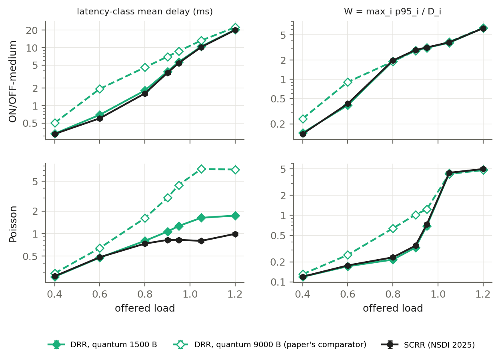

| point | latency mean, SCRR (ms) | latency mean, DRR-9000 (ms) | paired p | W SCRR | W DRR-1500 | W DRR-9000 | SCRR rank among 9 |
|---|---|---|---|---|---|---|---|
| onoff 0.4 | 0.32 | 0.50 | 1.9e-06 | 0.14 | 0.14 | 0.24 | 4 |
| onoff 0.6 | 0.60 | 1.94 | 1.9e-06 | 0.41 | 0.39 | 0.91 | 6 |
| onoff 0.8 | 1.63 | 4.55 | 1.9e-06 | 1.98 | 1.94 | 1.90 | 8 |
| onoff 0.9 | 3.67 | 6.98 | 1.9e-06 | 2.89 | 2.85 | 2.82 | 8 |
| onoff 0.95 | 5.41 | 8.67 | 1.9e-06 | 3.16 | 3.13 | 3.09 | 8 |
| onoff 1.05 | 10.22 | 13.24 | 1.9e-06 | 3.80 | 3.75 | 3.87 | 7 |
| onoff 1.2 | 20.02 | 22.31 | 1.9e-06 | 6.35 | 6.35 | 6.42 | 7 |
| poisson 0.4 | 0.27 | 0.29 | 1.9e-06 | 0.12 | 0.12 | 0.13 | 6 |
| poisson 0.6 | 0.48 | 0.64 | 1.9e-06 | 0.17 | 0.17 | 0.25 | 7 |
| poisson 0.8 | 0.73 | 1.61 | 1.9e-06 | 0.23 | 0.22 | 0.64 | 6 |
| poisson 0.9 | 0.82 | 3.02 | 1.9e-06 | 0.35 | 0.33 | 1.02 | 7 |
| poisson 0.95 | 0.82 | 4.47 | 1.9e-06 | 0.73 | 0.69 | 1.23 | 8 |
| poisson 1.05 | 0.80 | 7.33 | 1.9e-06 | 4.37 | 4.32 | 4.20 | 8 |
| poisson 1.2 | 0.99 | 7.21 | 1.9e-06 | 4.98 | 4.90 | 4.78 | 8 |

| SCRR paper claim | our test | result | verdict |
|---|---|---|---|
| (a) much lower application latency than DRR with a large quantum | latency-class mean delay below DRR-9000, paired p<0.05, at E1 loads >= 0.9 | 8/8 | **reproduced** |
| (b) fairness on par with DRR | |Jain(SCRR) - Jain(DRR)| <= 0.01 at the 3 E8 partitioned points | 0.95: -0.0000, 1.2: -0.0000, stress: -0.0003 | **reproduced** |

Facts: on this study's deadline-aware metric W, SCRR differs from DRR with a 1500 B quantum by -4% to +7% across the 14 E1 points and ranks 4-8 of 9 (median 7). SCRR targets fairness and sparse-flow latency without parameters; it does not use per-class delay targets, so a class-level, deadline-aware comparison is not where its advantages show. Its latency gain over a large-quantum DRR is large (table above).

## RQ4 — Parameter sensitivity (E6) and burstiness (E3)

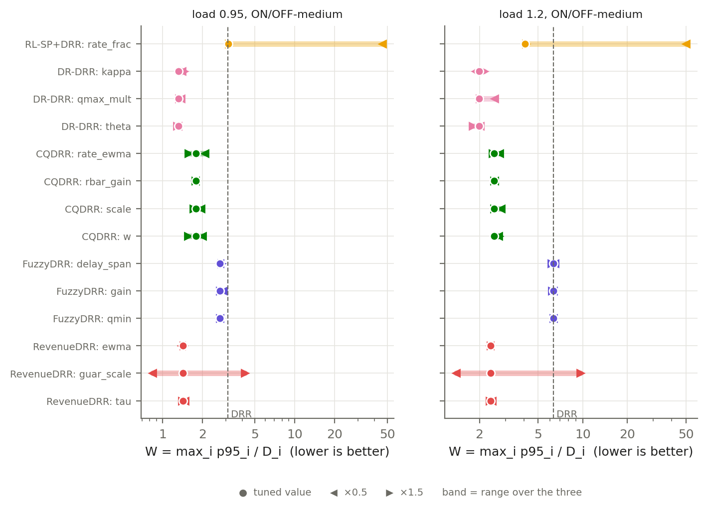

Change in W when one knob moves from its tuned value to ×0.5 / ×1.5, all others fixed, ON/OFF-medium:

| scheduler | knob | W tuned @0.95 | range @0.95 | W tuned @1.2 | range @1.2 |
|---|---|---|---|---|---|
| RL-SP+DRR | rate_frac | 3.16 | 3.16–45.80 | 4.05 | 4.05–50.01 |
| DR-DRR | kappa | 1.33 | 1.33–1.46 | 1.99 | 1.88–2.16 |
| DR-DRR | qmax_mult | 1.33 | 1.33–1.38 | 1.99 | 1.99–2.53 |
| DR-DRR | theta | 1.33 | 1.29–1.33 | 1.99 | 1.80–2.02 |
| CQDRR | rate_ewma | 1.78 | 1.58–2.10 | 2.51 | 2.46–2.74 |
| CQDRR | rbar_gain | 1.78 | 1.77–1.78 | 2.51 | 2.51–2.54 |
| CQDRR | scale | 1.78 | 1.71–1.96 | 2.51 | 2.51–2.79 |
| CQDRR | w | 1.78 | 1.56–2.01 | 2.51 | 2.51–2.73 |
| FuzzyDRR | delay_span | 2.73 | 2.72–2.79 | 6.32 | 6.12–6.51 |
| FuzzyDRR | gain | 2.73 | 2.71–2.89 | 6.32 | 6.20–6.32 |
| FuzzyDRR | qmin | 2.73 | 2.73–2.73 | 6.32 | 6.32–6.32 |
| RevenueDRR | ewma | 1.42 | 1.39–1.45 | 2.39 | 2.36–2.39 |
| RevenueDRR | guar_scale | 1.42 | 0.84–4.19 | 2.39 | 1.39–9.63 |
| RevenueDRR | tau | 1.42 | 1.41–1.48 | 2.39 | 2.35–2.43 |

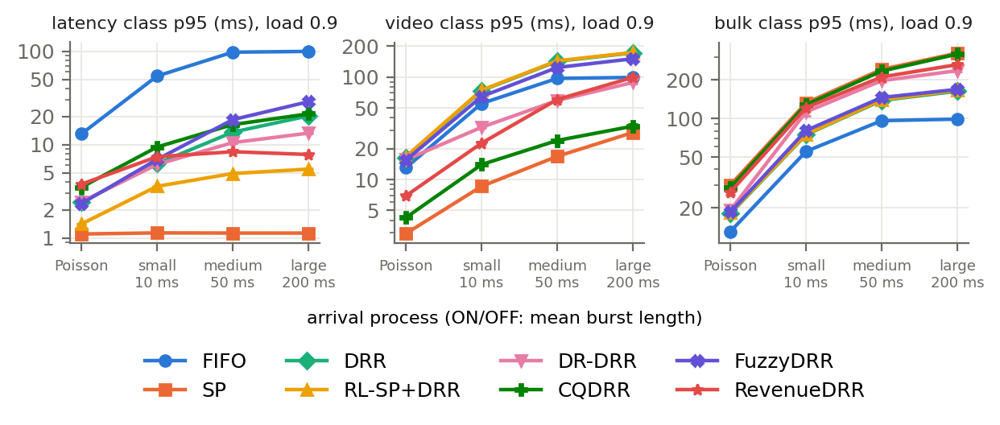

W by arrival process (load 0.9, E3):

| scheduler | poisson | onoff-small | onoff-medium | onoff-large |
|---|---|---|---|---|
| FIFO | 1.30 ± 0.05 | 5.42 ± 0.31 | 9.77 ± 0.04 | 9.95 ± 0.00 |
| SP | 0.11 ± 0.00 | 0.26 ± 0.02 | 0.48 ± 0.01 | 0.66 ± 0.03 |
| DRR | 0.33 ± 0.01 | 1.47 ± 0.10 | 2.85 ± 0.08 | 3.44 ± 0.09 |
| RL-SP+DRR | 0.33 ± 0.01 | 1.49 ± 0.10 | 2.88 ± 0.08 | 3.47 ± 0.09 |
| DR-DRR | 0.31 ± 0.01 | 0.65 ± 0.01 | 1.18 ± 0.03 | 1.77 ± 0.06 |
| CQDRR | 0.35 ± 0.00 | 0.94 ± 0.01 | 1.64 ± 0.05 | 2.13 ± 0.09 |
| FuzzyDRR | 0.31 ± 0.01 | 1.29 ± 0.06 | 2.48 ± 0.07 | 3.11 ± 0.10 |
| RevenueDRR | 0.38 ± 0.00 | 0.74 ± 0.00 | 1.21 ± 0.05 | 1.98 ± 0.11 |

## RQ5 — Do rankings hold across load, mix, buffer and seeds?

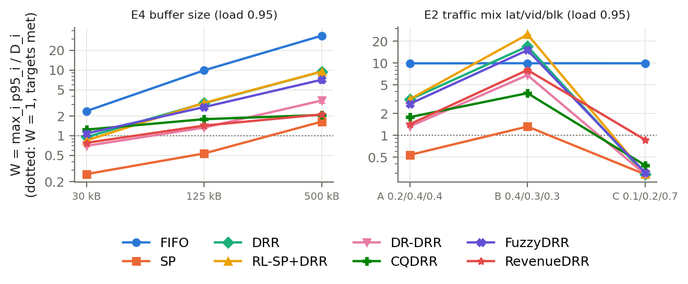

| exp | point | best mean rank on W | its share of seeds ranked 1st | best excluding SP | its share of seeds 1st (SP excluded) |
|---|---|---|---|---|---|
| E1 | poisson 0.4 | SP | 100% | RL-SP+DRR | 100% |
| E1 | onoff 0.4 | SP | 100% | RL-SP+DRR | 100% |
| E1 | poisson 0.6 | SP | 100% | RL-SP+DRR | 100% |
| E1 | onoff 0.6 | SP | 100% | DR-DRR | 85% |
| E1 | poisson 0.8 | SP | 100% | RL-SP+DRR | 100% |
| E1 | onoff 0.8 | SP | 100% | RevenueDRR | 80% |
| E1 | poisson 0.9 | SP | 100% | FuzzyDRR | 80% |
| E1 | onoff 0.9 | SP | 100% | DR-DRR | 55% |
| E1 | poisson 0.95 | SP | 100% | CQDRR | 100% |
| E1 | onoff 0.95 | SP | 100% | DR-DRR | 95% |
| E1 | poisson 1.05 | RevenueDRR | 100% | RevenueDRR | 100% |
| E1 | onoff 1.05 | SP | 100% | DR-DRR | 100% |
| E1 | poisson 1.2 | SP | 75% | RevenueDRR | 80% |
| E1 | onoff 1.2 | SP | 100% | DR-DRR | 100% |
| E2 | mix=A | SP | 100% | DR-DRR | 95% |
| E2 | mix=B | SP | 100% | CQDRR | 100% |
| E2 | mix=C | DR-DRR | 30% | DR-DRR | 50% |
| E3 | poisson | SP | 100% | FuzzyDRR | 80% |
| E3 | onoff-small | SP | 100% | DR-DRR | 100% |
| E3 | onoff-medium | SP | 100% | DR-DRR | 55% |
| E3 | onoff-large | SP | 100% | DR-DRR | 95% |
| E4 | buffer=small | SP | 100% | DR-DRR | 100% |
| E4 | buffer=medium | SP | 100% | DR-DRR | 95% |
| E4 | buffer=large | SP | 95% | CQDRR | 55% |
| E7 | poisson 0.3 | SP | 100% | RL-SP+DRR | 55% |
| E8 | partitioned 0.95 | SP | 100% | DR-DRR | 100% |
| E8 | partitioned 1.2 | SP | 100% | DR-DRR | 80% |
| E8 | partitioned stress | CQDRR | 100% | CQDRR | 100% |
| E8 | partitioned poisson1.2 | SP | 100% | RevenueDRR | 100% |

Facts:
- Best non-SP scheduler by lowest mean W across these points (the table above ranks by mean rank, which can differ at close points): DR-DRR 14/29, CQDRR 5/29, RL-SP+DRR 4/29, RevenueDRR 4/29, FuzzyDRR 2/29.
- Low-load control E7 (Poisson 0.3): W spans 0.089–0.110 across schedulers; latency-class p95 spans 0.89–1.10 ms (differences vanish as expected).

## E11 — Do the findings survive real-life conditions? (pre-registered)

Eight conditions the model did not cover (protocol section E11), all 8 schedulers + SCRR, tuned parameters frozen, 20 paired seeds each. Rules for 'holds' were fixed before the code for these scenarios existed.

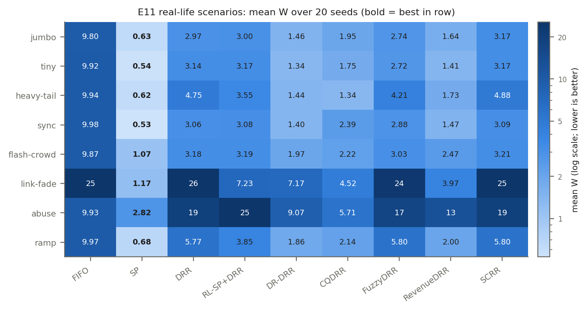

Mean W per scenario (lower is better; W <= 1 means every class met its p95 target):

| scenario | FIFO | SP | DRR | RL-SP+DRR | DR-DRR | CQDRR | FuzzyDRR | RevenueDRR | SCRR |
|---|---|---|---|---|---|---|---|---|---|
| jumbo | 9.80 | **0.63** | 2.97 | 3.00 | 1.46 | 1.95 | 2.74 | 1.64 | 3.17 |
| tiny | 9.92 | **0.54** | 3.14 | 3.17 | 1.34 | 1.75 | 2.72 | 1.41 | 3.17 |
| heavy-tail | 9.94 | **0.62** | 4.75 | 3.55 | 1.44 | 1.34 | 4.21 | 1.73 | 4.88 |
| sync | 9.98 | **0.53** | 3.06 | 3.08 | 1.40 | 2.39 | 2.88 | 1.47 | 3.09 |
| flash-crowd | 9.87 | **1.07** | 3.18 | 3.19 | 1.97 | 2.22 | 3.03 | 2.47 | 3.21 |
| link-fade | 24.89 | **1.17** | 25.62 | 7.23 | 7.17 | 4.52 | 23.61 | 3.97 | 25.26 |
| abuse | 9.93 | **2.82** | 18.96 | 24.89 | 9.07 | 5.71 | 17.46 | 12.68 | 19.04 |
| ramp | 9.97 | **0.68** | 5.77 | 3.85 | 1.86 | 2.14 | 5.80 | 2.00 | 5.80 |

| scenario | F1 lowest latency p95 | F2 starving schedulers | F4 drop-rate spread (pp) | F5 DR-DRR - DRR in W (p) | best non-SP on W |
|---|---|---|---|---|---|
| jumbo | SP (holds) | CQDRR, FIFO, SP (**fails**) | 0.63 (holds) | -1.51 (p=1.9e-06; holds) | DR-DRR |
| tiny | SP (holds) | CQDRR, FIFO, SP (**fails**) | 0.28 (holds) | -1.80 (p=1.9e-06; holds) | DR-DRR |
| heavy-tail | SP (holds) | CQDRR, FIFO, SP (**fails**) | 0.57 (holds) | -3.32 (p=1.9e-06; holds) | CQDRR |
| sync | SP (holds) | CQDRR, SP (holds) | 0.78 (holds) | -1.66 (p=1.9e-06; holds) | DR-DRR |
| flash-crowd | SP (holds) | CQDRR, FIFO, SP (**fails**) | 0.27 (holds) | -1.21 (p=1.9e-06; holds) | DR-DRR |
| link-fade | SP (holds) | CQDRR, FIFO, SP (**fails**) | 0.80 (holds) | -18.45 (p=1.9e-06; holds) | RevenueDRR |
| abuse | SP (holds) | CQDRR, SP (holds) | 19.38 (**fails**) | -9.89 (p=1.9e-06; holds) | CQDRR |
| ramp | SP (holds) | CQDRR, FIFO, SP (**fails**) | 0.62 (holds) | -3.90 (p=1.9e-06; holds) | DR-DRR |

**Pre-registered verdicts across the 8 scenarios:**

- **F1** SP gives the lowest latency-class p95: holds in 8/8.
- **F2** only SP and CQDRR ever starve a class: holds in 2/8.
- **F3** no single best non-SP scheduler: **holds** (winners: DR-DRR 5, CQDRR 2, RevenueDRR 1).
- **F4** shared buffer makes drop rates scheduler-independent (spread <= 1 pp): holds in 7/8.
- **F5** DR-DRR beats DRR on W: holds in 8/8.

**Why the failures happen (computed from the same runs):**

- F2: in 6 of the 6 failing scenarios the only extra scheduler is FIFO, whose episodes are long waits in one FIFO queue (longest 251 ms), not service denial; the pre-registered wording omitted FIFO, which shows the same behaviour in the main study. The DRR-family schedulers (DRR, RL-SP+DRR, DR-DRR, FuzzyDRR, RevenueDRR, SCRR) have 0 starvation episodes in all 8 scenarios.
- F4 in 'abuse': excluding RL-SP+DRR, the only non-work-conserving scheduler, the drop-rate spread is 0.60 pp, so the shared-buffer finding holds for every work-conserving scheduler. RL-SP+DRR holds the mislabelled class's excess (its shaper allows less than the class sends) inside the shared buffer: its drop rates rise to 35 % and total throughput falls to 7.89 Mb/s versus 9.51 Mb/s for the others: the link idles while its buffer is full of packets the shaper will not release.

Robustness of each scheduler across the 8 scenarios (rank by mean W, 1 = best of 9):

| scheduler | mean rank | worst rank | scenarios with all targets met (W <= 1) |
|---|---|---|---|
| SP | 1.0 | 1 | 5/8 |
| DR-DRR | 2.5 | 4 | 0/8 |
| CQDRR | 3.2 | 4 | 0/8 |
| RevenueDRR | 3.4 | 5 | 0/8 |
| FuzzyDRR | 5.6 | 7 | 0/8 |
| DRR | 6.6 | 9 | 0/8 |
| RL-SP+DRR | 6.6 | 9 | 0/8 |
| SCRR | 7.9 | 8 | 0/8 |
| FIFO | 8.1 | 9 | 0/8 |

## E12 — More real-life conditions and checks of the method (pre-registered)

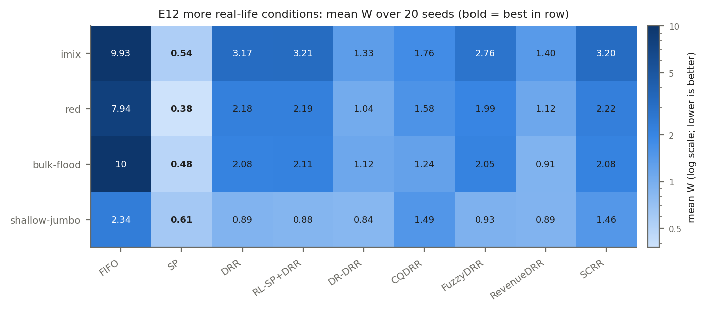

| scenario | FIFO | SP | DRR | RL-SP+DRR | DR-DRR | CQDRR | FuzzyDRR | RevenueDRR | SCRR |
|---|---|---|---|---|---|---|---|---|---|
| imix | 9.93 | **0.54** | 3.17 | 3.21 | 1.33 | 1.76 | 2.76 | 1.40 | 3.20 |
| red | 7.94 | **0.38** | 2.18 | 2.19 | 1.04 | 1.58 | 1.99 | 1.12 | 2.22 |
| bulk-flood | 10.03 | **0.48** | 2.08 | 2.11 | 1.12 | 1.24 | 2.05 | 0.91 | 2.08 |
| shallow-jumbo | 2.34 | **0.61** | 0.89 | 0.88 | 0.84 | 1.49 | 0.93 | 0.89 | 1.46 |

| scenario | F1 lowest latency p95 | F2' DRR-family starvation episodes | F4 drop spread (pp, reported) | F5 DR-DRR - DRR in W (p) | best non-SP on W |
|---|---|---|---|---|---|
| imix | SP (holds) | 0 (holds) | 0.22 | -1.84 (p=1.9e-06; holds) | DR-DRR |
| red | SP (holds) | 0 (holds) | 0.11 | -1.14 (p=1.9e-06; holds) | DR-DRR |
| bulk-flood | SP (holds) | 0 (holds) | 4.00 | -0.95 (p=1.9e-06; holds) | RevenueDRR |
| shallow-jumbo | SP (holds) | 0 (holds) | 0.58 | -0.06 (p=1.9e-06; holds) | DR-DRR |

Verdicts: **F1** 4/4; **F2'** 4/4; **F3** holds (winners: DR-DRR 3, RevenueDRR 1); **F5** 4/4.

**M1 — does a 10x longer measurement window change anything?** (600 s instead of 60 s, seeds 101-110)

| load | order of the 8 by mean W unchanged? | largest change in a scheduler's mean W | verdict |
|---|---|---|---|
| 0.95 | yes | 2.0% (RevenueDRR) | passes |
| 1.2 | no | 5.2% (DRR) | **fails** |

- Why M1 fails: at load 1.2, DRR and FuzzyDRR swap places: 600-s mean W 6.477 ± 0.163 vs 6.407 ± 0.100 (overlapping intervals: a statistical tie).

**M2 — are 20 seeds enough?** (100 seeds vs. E1's 20-seed 95 % interval, ON/OFF 0.95)

| scheduler | 20-seed mean W ± CI | 100-seed mean W | inside? |
|---|---|---|---|
| FIFO | 9.908 ± 0.007 | 9.904 | yes |
| SP | 0.535 ± 0.014 | 0.534 | yes |
| DRR | 3.126 ± 0.084 | 3.109 | yes |
| RL-SP+DRR | 3.159 ± 0.083 | 3.143 | yes |
| DR-DRR | 1.326 ± 0.028 | 1.309 | yes |
| CQDRR | 1.784 ± 0.038 | 1.806 | yes |
| FuzzyDRR | 2.726 ± 0.069 | 2.715 | yes |
| RevenueDRR | 1.425 ± 0.045 | 1.391 | yes |

M1 **fails**; M2: 8/8 inside, order unchanged -> passes.

## E13 — Published examples re-created in this simulator (pre-registered)

Run `20261023-114848` (code 803154ed67fe7b29). Each benchmark rebuilds a setup printed in a paper, runs it through the normal engine, and compares with the paper's own numbers. DRR-EOS is DRR with the end-of-service rule used in network calculus (a class keeps its turn if a packet arrives while its last packet is on the link); DRR is the dequeue-time rule of Linux `sch_drr` used everywhere else in this study.

| bench | case | scheduler | quantity | ours | published | unit | verdict |
|---|---|---|---|---|---|---|---|
| B1 | paper trajectory | DRR-EOS | delay of packet of interest | 119.2557 | 119.256 | us | pass |
| B1 | paper trajectory | DRR | delay of packet of interest | 119.2557 | 119.256 | us | pass |
| B1 | 2000 random token-bucket inputs | DRR-EOS | max flow-1 delay (<= Boyer bound) | 127.628 | 146.228 | us | pass |
| B2 | 3000 token-bucket inputs | DRR-EOS | max delay, electric protection | 37.312 | 44.51 | us | pass (tightness 0.838) |
| B2 | 3000 token-bucket inputs | DRR-EOS | max delay, VR games | 1306.336 | 1320.0 | us | pass (tightness 0.990) |
| B2 | 3000 token-bucket inputs | DRR-EOS | max delay, video conference | 1802.84 | 1810.0 | us | pass (tightness 0.996) |
| B2 | 3000 token-bucket inputs | DRR-EOS | max delay, 4k video | 2715.168 | 2720.0 | us | pass (tightness 0.998) |
| B2 | 3000 token-bucket inputs | DRR | max delay, electric protection | 39.712 | 44.51 | us | pass (tightness 0.892) |
| B2 | 3000 token-bucket inputs | DRR | max delay, VR games | 1308.736 | 1320.0 | us | pass (tightness 0.991) |
| B2 | 3000 token-bucket inputs | DRR | max delay, video conference | 1804.352 | 1810.0 | us | pass (tightness 0.997) |
| B2 | 3000 token-bucket inputs | DRR | max delay, 4k video | 2715.168 | 2720.0 | us | pass (tightness 0.998) |
| B3 | bimodal sizes, unlimited buffer, 20 seeds | DRR | ill-behaved / mean of others | 1.002 ± 0.000 | FCFS: 'arbitrary share'; DRR: 'nearly perfect fairness' | ratio | descriptive |
| B3 | bimodal sizes, unlimited buffer | DRR | max deviation of well-behaved flows from their mean | 0.0012 | 0.0032 | fraction | descriptive |
| B3 | bimodal sizes, unlimited, link scaled (post hoc) buffer, 20 seeds | DRR | ill-behaved / mean of others | 1.002 ± 0.000 | FCFS: 'arbitrary share'; DRR: 'nearly perfect fairness' | ratio | descriptive |
| B3 | bimodal sizes, unlimited, link scaled (post hoc) buffer | DRR | max deviation of well-behaved flows from their mean | 0.0014 | 0.0032 | fraction | descriptive |
| B3 | constant sizes, unlimited buffer, 20 seeds | DRR | ill-behaved / mean of others | 2.994 ± 0.005 | FCFS: 'arbitrary share'; DRR: 'nearly perfect fairness' | ratio | descriptive |
| B3 | constant sizes, unlimited buffer | DRR | max deviation of well-behaved flows from their mean | 0.0143 | 0.003 | fraction | descriptive |
| B3 | constant sizes, unlimited, link scaled (post hoc) buffer, 20 seeds | DRR | ill-behaved / mean of others | 1.007 ± 0.000 | FCFS: 'arbitrary share'; DRR: 'nearly perfect fairness' | ratio | descriptive |
| B3 | constant sizes, unlimited, link scaled (post hoc) buffer | DRR | max deviation of well-behaved flows from their mean | 0.0018 | 0.003 | fraction | descriptive |
| B3 | random sizes, partitioned buffer, 20 seeds | DRR | ill-behaved / mean of others | 1.003 ± 0.000 | FCFS: 'arbitrary share'; DRR: 'nearly perfect fairness' | ratio | descriptive |
| B3 | random sizes, shared buffer, 20 seeds | DRR | ill-behaved / mean of others | 2.964 ± 0.009 | FCFS: 'arbitrary share'; DRR: 'nearly perfect fairness' | ratio | descriptive |
| B3 | random sizes, unlimited buffer, 20 seeds | DRR | ill-behaved / mean of others | 1.001 ± 0.000 | FCFS: 'arbitrary share'; DRR: 'nearly perfect fairness' | ratio | pass |
| B3 | random sizes, unlimited buffer | DRR | max deviation of well-behaved flows from their mean | 0.0009 | 0.004699 | fraction | descriptive |
| B3 | bimodal sizes, unlimited buffer, 20 seeds | FIFO | ill-behaved / mean of others | 2.995 ± 0.011 | FCFS: 'arbitrary share'; DRR: 'nearly perfect fairness' | ratio | descriptive |
| B3 | bimodal sizes, unlimited, link scaled (post hoc) buffer, 20 seeds | FIFO | ill-behaved / mean of others | 2.996 ± 0.011 | FCFS: 'arbitrary share'; DRR: 'nearly perfect fairness' | ratio | descriptive |
| B3 | constant sizes, unlimited buffer, 20 seeds | FIFO | ill-behaved / mean of others | 2.994 ± 0.005 | FCFS: 'arbitrary share'; DRR: 'nearly perfect fairness' | ratio | descriptive |
| B3 | constant sizes, unlimited, link scaled (post hoc) buffer, 20 seeds | FIFO | ill-behaved / mean of others | 2.993 ± 0.006 | FCFS: 'arbitrary share'; DRR: 'nearly perfect fairness' | ratio | descriptive |
| B3 | random sizes, partitioned buffer, 20 seeds | FIFO | ill-behaved / mean of others | 1.229 ± 0.001 | FCFS: 'arbitrary share'; DRR: 'nearly perfect fairness' | ratio | descriptive |
| B3 | random sizes, shared buffer, 20 seeds | FIFO | ill-behaved / mean of others | 2.997 ± 0.008 | FCFS: 'arbitrary share'; DRR: 'nearly perfect fairness' | ratio | descriptive |
| B3 | random sizes, unlimited buffer, 20 seeds | FIFO | ill-behaved / mean of others | 2.995 ± 0.010 | FCFS: 'arbitrary share'; DRR: 'nearly perfect fairness' | ratio | pass |
| B3 | bimodal sizes, unlimited buffer, 20 seeds | SCRR | ill-behaved / mean of others | 1.001 ± 0.000 | FCFS: 'arbitrary share'; DRR: 'nearly perfect fairness' | ratio | descriptive |
| B3 | bimodal sizes, unlimited, link scaled (post hoc) buffer, 20 seeds | SCRR | ill-behaved / mean of others | 1.001 ± 0.000 | FCFS: 'arbitrary share'; DRR: 'nearly perfect fairness' | ratio | descriptive |
| B3 | constant sizes, unlimited buffer, 20 seeds | SCRR | ill-behaved / mean of others | 2.994 ± 0.005 | FCFS: 'arbitrary share'; DRR: 'nearly perfect fairness' | ratio | descriptive |
| B3 | constant sizes, unlimited, link scaled (post hoc) buffer, 20 seeds | SCRR | ill-behaved / mean of others | 1.001 ± 0.000 | FCFS: 'arbitrary share'; DRR: 'nearly perfect fairness' | ratio | descriptive |
| B3 | random sizes, partitioned buffer, 20 seeds | SCRR | ill-behaved / mean of others | 1.002 ± 0.000 | FCFS: 'arbitrary share'; DRR: 'nearly perfect fairness' | ratio | descriptive |
| B3 | random sizes, shared buffer, 20 seeds | SCRR | ill-behaved / mean of others | 2.963 ± 0.008 | FCFS: 'arbitrary share'; DRR: 'nearly perfect fairness' | ratio | descriptive |
| B3 | random sizes, unlimited buffer, 20 seeds | SCRR | ill-behaved / mean of others | 1.001 ± 0.000 | FCFS: 'arbitrary share'; DRR: 'nearly perfect fairness' | ratio | descriptive |
| B4 | high priority on, 20 seeds | DRR | high / medium / low throughput | 3.333 / 3.333 / 3.333 | high 5.3 (RL-SP-DRR and STRICT) | Mb/s | descriptive |
| B4 | high priority off, 20 seeds | DRR | high / medium / low throughput | 0.000 / 5.000 / 5.000 | - | Mb/s | descriptive |
| B4 | high priority on, 20 seeds | FIFO | high / medium / low throughput | 3.333 / 3.333 / 3.333 | high 5.3 (RL-SP-DRR and STRICT) | Mb/s | descriptive |
| B4 | high priority off, 20 seeds | FIFO | high / medium / low throughput | 0.000 / 5.000 / 5.000 | - | Mb/s | descriptive |
| B4 | high priority on, 20 seeds | RL-SP+DRR | high / medium / low throughput | 6.000 / 2.000 / 2.000 | high 5.3 (RL-SP-DRR and STRICT) | Mb/s | pass |
| B4 | high priority off, 20 seeds | RL-SP+DRR | high / medium / low throughput | 0.000 / 5.000 / 5.000 | - | Mb/s | descriptive |
| B4 | high priority on, 20 seeds | SP | high / medium / low throughput | 9.815 / 0.185 / 0.000 | high 5.3 (RL-SP-DRR and STRICT) | Mb/s | descriptive |
| B4 | high priority off, 20 seeds | SP | high / medium / low throughput | 0.000 / 9.819 / 0.181 | - | Mb/s | descriptive |
| B5 | 1000 random traces, backlogged | SCRR (as printed) | max clock advance per round / M (Thm 1: <= 1) | 2.0 | 1 | M | fail (305 traces) |
| B5 | 1000 random traces, backlogged | SCRR (as printed) | max burst of one visit / M (Thm 2: <= 2) | 2.682 | 2 | M | fail (39 traces) |
| B5 | 1000 random traces, backlogged | SCRR (as printed) | max advance when the queue empties / M (no theorem) | 2.149 | - | M | descriptive |
| B5 | 1000 random traces, dynamic arrivals | SCRR (as printed) | max clock advance per round / M (Thm 1: <= 1) | 2.0 | 1 | M | descriptive (298 traces exceed) |
| B5 | 1000 random traces, dynamic arrivals | SCRR (as printed) | max burst of one visit / M (Thm 2: <= 2) | 3.0 | 2 | M | descriptive (54 traces exceed) |
| B5 | 1000 random traces, dynamic arrivals | SCRR (as printed) | max advance when the queue empties / M (no theorem) | 3.0 | - | M | descriptive |
| B5 | 1000 random traces, backlogged | SCRR (round-first) | max clock advance per round / M (Thm 1: <= 1) | 1.0 | 1 | M | descriptive (0 traces exceed) |
| B5 | 1000 random traces, backlogged | SCRR (round-first) | max burst of one visit / M (Thm 2: <= 2) | 1.992 | 2 | M | descriptive (0 traces exceed) |
| B5 | 1000 random traces, backlogged | SCRR (round-first) | max advance when the queue empties / M (no theorem) | 3.0 | - | M | descriptive |
| B5 | 1000 random traces, dynamic arrivals | SCRR (round-first) | max clock advance per round / M (Thm 1: <= 1) | 1.0 | 1 | M | descriptive (0 traces exceed) |
| B5 | 1000 random traces, dynamic arrivals | SCRR (round-first) | max burst of one visit / M (Thm 2: <= 2) | 2.0 | 2 | M | descriptive (0 traces exceed) |
| B5 | 1000 random traces, dynamic arrivals | SCRR (round-first) | max advance when the queue empties / M (no theorem) | 3.0 | - | M | descriptive |

**14/16 pre-registered comparisons pass.**

- **B1** (Tabatabaee & Le Boudec): the paper's trajectory gives the published 119.256 µs to the printed precision, under both DRR rules, and the service order (10, 62, 4, 10, 1 packets) is the paper's. The DRR rule only changes how flow 3's first two turns split (10+10 vs 11+9), not the delay.
- **B2** (Bouillard's 4-class server): no input ever exceeded a published bound; the worst observed delays reach 83.8%–99.8% of the bounds, so the bounds of Thm. 5 are nearly tight (the video classes within 1 %). The dequeue-time rule adds one 1500 B packet time (2.4 µs) for the small-packet class and stays inside the bound.
- **B3** (original DRR, Fig. 7): with per-flow isolation DRR gives the ill-behaved flow its fair share and FIFO gives it about 3x (the paper: an 'arbitrary share'). With one shared tail-drop buffer DRR is as unfair as FIFO: the ill-behaved flow takes the buffer, and the scheduler cannot serve packets that were dropped. The original paper avoids this with McKenney's buffer stealing (drop from the longest queue); our partitioned buffer has the same effect. The link rate (400 kb/s) is our assumption; the paper does not give it. With constant 100-bit packets that link is never congested, so every flow gets what it sends; with the link scaled to the same overload (post hoc) DRR is fair for all three size models, as the paper reports (Fig. 9).
- **B4** (RL-SP-DRR PROACTIVE): high priority gets exactly the configured 60 % (6.0 Mb/s) and medium/low split the rest 2.0/2.0; the testbed's 5.3 Mb/s is lower, which we attribute to iperf/bmv2 overheads we do not model. Unshaped SP gives high priority ~9.8 Mb/s and starves low priority; the paper's STRICT also reached only 5.3 because it was rate-limited.
- **B5** (SCRR theorems): the global-clock advance per round exceeds M and a visit's burst exceeds 2M for SCRR as printed in Algorithm 4. The cause: the pseudo-code closes a finished round one dequeue late, after the next round's first packet has already raised `virtual_dequeue`. A diagnostic variant that closes the round first (added after this result, not pre-registered) exceeds a bound on 0 trace(s), so the theorems hold for the algorithm they describe and the printed ordering differs from it. Our compared SCRR stays as printed.
- Registered comparisons that fail: B5 SCRR (as printed) max clock advance per round / M (Thm 1: <= 1); B5 SCRR (as printed) max burst of one visit / M (Thm 2: <= 2).
- Not reproducible: WiOpt 2025 (Mukherjee et al.) Table II: inconsistent units and no stated arrival process.

## E14 — DR-DRR ablation (pre-registered)

Both simplified variants were tuned with DR-DRR's own rule on dev seeds: {'DR-DRR-backlog': {'kappa': 4.0}, 'DR-DRR-hol': {'kappa': 8.0}}. Same traces as E1 (280 (point, seed) groups, one trace each). Paired difference = W(variant) - W(DR-DRR); Holm correction over the 14 points of each variant.

| point | DRR | DR-DRR | DR-DRR-backlog | DR-DRR-hol | DR-DRR+damping |
|---|---|---|---|---|---|
| poisson|0.4 | 0.119 ± 0.000 | 0.119 ± 0.000 | 0.119 ± 0.000 | 0.119 ± 0.000 | 0.119 ± 0.000 |
| onoff|0.4 | 0.144 ± 0.002 | 0.144 ± 0.002 | 0.144 ± 0.002 | 0.144 ± 0.002 | 0.144 ± 0.002 |
| poisson|0.6 | 0.172 ± 0.001 | 0.172 ± 0.001 | 0.172 ± 0.001 | 0.172 ± 0.001 | 0.172 ± 0.001 |
| onoff|0.6 | 0.392 ± 0.018 | 0.361 ± 0.012 | 0.361 ± 0.012 | 0.385 ± 0.016 | 0.366 ± 0.012 |
| poisson|0.8 | 0.216 ± 0.001 | 0.216 ± 0.001 | 0.216 ± 0.001 | 0.216 ± 0.001 | 0.217 ± 0.001 |
| onoff|0.8 | 1.936 ± 0.103 | 0.843 ± 0.026 | 0.868 ± 0.026 | 0.895 ± 0.017 | 0.878 ± 0.021 |
| poisson|0.9 | 0.328 ± 0.012 | 0.311 ± 0.007 | 0.312 ± 0.007 | 0.319 ± 0.009 | 0.312 ± 0.007 |
| onoff|0.9 | 2.847 ± 0.085 | 1.181 ± 0.026 | 1.206 ± 0.031 | 1.113 ± 0.019 | 1.146 ± 0.023 |
| poisson|0.95 | 0.689 ± 0.057 | 0.447 ± 0.006 | 0.449 ± 0.007 | 0.505 ± 0.010 | 0.453 ± 0.007 |
| onoff|0.95 | 3.126 ± 0.084 | 1.326 ± 0.028 | 1.352 ± 0.032 | 1.215 ± 0.018 | 1.263 ± 0.021 |
| poisson|1.05 | 4.315 ± 0.060 | 0.901 ± 0.035 | 1.138 ± 0.034 | 0.634 ± 0.004 | 0.613 ± 0.005 |
| onoff|1.05 | 3.754 ± 0.151 | 1.577 ± 0.026 | 1.621 ± 0.029 | 1.416 ± 0.021 | 1.484 ± 0.020 |
| poisson|1.2 | 4.897 ± 0.014 | 1.326 ± 0.014 | 1.393 ± 0.018 | 0.646 ± 0.004 | 0.652 ± 0.005 |
| onoff|1.2 | 6.351 ± 0.383 | 1.990 ± 0.028 | 1.993 ± 0.034 | 1.735 ± 0.027 | 1.897 ± 0.024 |

**DR-DRR-backlog vs DR-DRR**: DR-DRR significantly better at 9/14 points, worse at 0/14 -> **the full rule adds value**.

| point | mean W(variant) - W(DR-DRR) ± 95 % CI | Holm p |
|---|---|---|
| poisson|0.4 | +0.000 ± 0.000 | 1 |
| onoff|0.4 | +0.000 ± 0.000 | 1 |
| poisson|0.6 | +0.000 ± 0.000 | 1 |
| onoff|0.6 | +0.000 ± 0.000 | 0.0068 |
| poisson|0.8 | -0.000 ± 0.000 | 0.54 |
| onoff|0.8 | +0.025 ± 0.007 | 2.7e-05 |
| poisson|0.9 | +0.001 ± 0.000 | 0.0039 |
| onoff|0.9 | +0.025 ± 0.014 | 0.0071 |
| poisson|0.95 | +0.002 ± 0.001 | 0.0043 |
| onoff|0.95 | +0.025 ± 0.016 | 0.029 |
| poisson|1.05 | +0.237 ± 0.030 | 2.7e-05 |
| onoff|1.05 | +0.044 ± 0.013 | 4.6e-05 |
| poisson|1.2 | +0.067 ± 0.019 | 0.0001 |
| onoff|1.2 | +0.003 ± 0.030 | 1 |

**DR-DRR-hol vs DR-DRR**: DR-DRR significantly better at 4/14 points, worse at 6/14 -> **mixed**.

| point | mean W(variant) - W(DR-DRR) ± 95 % CI | Holm p |
|---|---|---|
| poisson|0.4 | +0.000 ± 0.000 | 1 |
| onoff|0.4 | +0.000 ± 0.000 | 0.95 |
| poisson|0.6 | +0.000 ± 0.000 | 1 |
| onoff|0.6 | +0.024 ± 0.004 | 2.7e-05 |
| poisson|0.8 | -0.000 ± 0.000 | 0.26 |
| onoff|0.8 | +0.052 ± 0.014 | 4.8e-05 |
| poisson|0.9 | +0.008 ± 0.002 | 2.7e-05 |
| onoff|0.9 | -0.068 ± 0.016 | 2.7e-05 |
| poisson|0.95 | +0.058 ± 0.004 | 2.7e-05 |
| onoff|0.95 | -0.112 ± 0.017 | 2.7e-05 |
| poisson|1.05 | -0.267 ± 0.034 | 2.7e-05 |
| onoff|1.05 | -0.162 ± 0.017 | 2.7e-05 |
| poisson|1.2 | -0.679 ± 0.013 | 2.7e-05 |
| onoff|1.2 | -0.255 ± 0.033 | 2.7e-05 |

Starvation episodes (> 100 ms) and the longest service gap over the 14 points: DRR 0 episodes, longest gap 4.6 ms; DR-DRR 0 episodes, longest gap 20.3 ms; DR-DRR-backlog 0 episodes, longest gap 20.3 ms; DR-DRR-hol 0 episodes, longest gap 20.3 ms; DR-DRR+damping 0 episodes, longest gap 19.8 ms.

## E15 — held-out seeds 201-220 (pre-registered)

- **H1** SP lowest latency p95 on held-out seeds: 14/14 -> holds.
- **H2** same best non-SP scheduler as with seeds 101-120: 14/14 -> holds.
- **H3** held-out mean W inside the 101-120 interval (points per scheduler): FIFO 13/14, SP 11/14, DRR 14/14, RL-SP+DRR 12/14, DR-DRR 14/14, CQDRR 9/14, FuzzyDRR 14/14, RevenueDRR 12/14 -> **fails**.
- Why H3 can fail by chance: a new mean is itself noisy, so it falls inside the old 95 % interval with probability about 0.84 (difference of two independent 20-seed means), i.e. about 11.8 of 14 points per scheduler. Observed overall: 99/112 = 0.88. The registered threshold (>= 11 of 14 for every one of 8 schedulers) was strict; the verdict stays as registered.

## E16 — real Linux kernel schedulers (pre-registered)

Run `20261023-181124`: Linux tbf (10 Mb/s) with a byte FIFO, prio (3 bands) or drr (quantum 1500 B) in WSL2, the simulator's own traces (10 s, seeds 101-103), compared with the simulator on the same packets. Delay = waiting time before service.

| point | scheduler | class | kernel mean (ms) | simulator mean (ms) | kernel p95 | simulator p95 | kernel drop | simulator drop |
|---|---|---|---|---|---|---|---|---|
| onoff|0.8 | FIFO | lat | 18.11 | 15.80 | 65.50 | 56.78 | 0.002 | 0.000 |
| onoff|0.8 | FIFO | vid | 21.82 | 18.30 | 71.43 | 63.67 | 0.009 | 0.003 |
| onoff|0.8 | FIFO | blk | 20.74 | 17.32 | 67.38 | 59.13 | 0.009 | 0.004 |
| onoff|0.8 | SP | lat | 0.14 | 0.46 | 0.64 | 1.11 | 0.000 | 0.000 |
| onoff|0.8 | SP | vid | 2.97 | 2.64 | 10.70 | 9.20 | 0.000 | 0.000 |
| onoff|0.8 | SP | blk | 28.54 | 24.92 | 103.24 | 86.16 | 0.073 | 0.062 |
| onoff|0.8 | DRR | lat | 2.15 | 1.59 | 7.52 | 5.52 | 0.000 | 0.000 |
| onoff|0.8 | DRR | vid | 18.50 | 16.53 | 62.25 | 56.28 | 0.025 | 0.020 |
| onoff|0.8 | DRR | blk | 19.14 | 17.11 | 63.68 | 58.54 | 0.025 | 0.018 |
| onoff|0.95 | FIFO | lat | 46.65 | 44.69 | 93.36 | 91.57 | 0.013 | 0.009 |
| onoff|0.95 | FIFO | vid | 48.86 | 46.36 | 97.40 | 95.43 | 0.058 | 0.049 |
| onoff|0.95 | FIFO | blk | 47.85 | 45.09 | 97.76 | 94.26 | 0.058 | 0.051 |
| onoff|0.95 | SP | lat | 0.18 | 0.52 | 0.84 | 1.14 | 0.000 | 0.000 |
| onoff|0.95 | SP | vid | 7.31 | 6.32 | 26.82 | 22.87 | 0.004 | 0.002 |
| onoff|0.95 | SP | blk | 49.40 | 44.98 | 163.69 | 146.00 | 0.229 | 0.205 |
| onoff|0.95 | DRR | lat | 5.71 | 4.68 | 19.57 | 16.08 | 0.000 | 0.000 |
| onoff|0.95 | DRR | vid | 33.00 | 30.41 | 82.40 | 77.58 | 0.092 | 0.080 |
| onoff|0.95 | DRR | blk | 33.61 | 30.98 | 83.81 | 79.65 | 0.117 | 0.108 |
| poisson|0.9 | FIFO | lat | 5.51 | 3.83 | 23.28 | 11.82 | 0.000 | 0.000 |
| poisson|0.9 | FIFO | vid | 6.20 | 3.82 | 24.17 | 11.81 | 0.000 | 0.000 |
| poisson|0.9 | FIFO | blk | 6.37 | 3.77 | 24.19 | 11.51 | 0.000 | 0.000 |
| poisson|0.9 | SP | lat | 0.08 | 0.50 | 0.28 | 1.10 | 0.000 | 0.000 |
| poisson|0.9 | SP | vid | 1.05 | 1.07 | 3.18 | 2.85 | 0.000 | 0.000 |
| poisson|0.9 | SP | blk | 11.34 | 8.17 | 39.24 | 27.30 | 0.001 | 0.000 |
| poisson|0.9 | DRR | lat | 1.05 | 1.06 | 2.66 | 2.41 | 0.000 | 0.000 |
| poisson|0.9 | DRR | vid | 4.99 | 4.59 | 18.08 | 16.37 | 0.000 | 0.000 |
| poisson|0.9 | DRR | blk | 5.19 | 4.35 | 19.51 | 15.09 | 0.000 | 0.000 |

- **K1** kernel mean within 10 % + 0.5 ms of the simulator: 18/27 cells -> **fails**.
- **K2** same order of the three schedulers by latency-class p95: 3/3 points -> holds.
- Why K1 fails (measured, FIFO and DRR runs): back-to-back departures are exactly one transmission time apart (median ratio 1.000), but timer stalls in the virtual machine lower the aggregate service rate to 9.64-9.95 Mb/s, which raises queueing delay near full load; and tbf's 1600 B bucket lets a small packet leave right after a large one, so SP's latency class waits less in the kernel than in the non-preemptive model.

## E17 — real backbone traffic (pre-registered)

Source: https://mawi.wide.ad.jp/mawi/samplepoint-F/2024/202401011400.pcap.gz (first 152 MB, sha256 c76ac9380453d54b..., 1,000,000 packets over 6.7 s; byte shares latency/video/bulk 12.7%/7.8%/79.6%). 10 windows of 100,000 packets; times scaled to the target load.

**Load 0.8**

| scheduler | mean W | latency p95 (ms) | video p95 (ms) | bulk p95 (ms) | starvation episodes |
|---|---|---|---|---|---|
| SP | 0.509 | 1.13 | 23.9 | 110.8 | 6 |
| CQDRR | 0.657 | 2.77 | 30.9 | 110.4 | 1 |
| DR-DRR | 0.755 | 2.41 | 37.6 | 110.1 | 0 |
| RevenueDRR | 0.957 | 7.41 | 38.5 | 109.5 | 0 |
| FuzzyDRR | 1.109 | 2.35 | 55.3 | 109.4 | 0 |
| SCRR | 1.161 | 2.36 | 57.7 | 109.7 | 0 |
| DRR | 1.179 | 2.24 | 58.8 | 109.4 | 0 |
| RL-SP+DRR | 1.205 | 3.27 | 58.9 | 109.4 | 0 |
| FIFO | 9.376 | 93.76 | 89.0 | 95.1 | 2 |

**Load 0.95**

| scheduler | mean W | latency p95 (ms) | video p95 (ms) | bulk p95 (ms) | starvation episodes |
|---|---|---|---|---|---|
| SP | 0.509 | 1.15 | 23.5 | 123.3 | 5 |
| CQDRR | 0.675 | 3.54 | 30.9 | 122.5 | 1 |
| DR-DRR | 0.786 | 3.11 | 39.2 | 121.8 | 0 |
| RevenueDRR | 0.972 | 7.98 | 39.5 | 121.4 | 0 |
| FuzzyDRR | 1.238 | 3.14 | 61.8 | 121.0 | 0 |
| SCRR | 1.268 | 3.10 | 62.9 | 121.5 | 0 |
| DRR | 1.292 | 2.93 | 64.5 | 121.0 | 0 |
| RL-SP+DRR | 1.321 | 4.07 | 65.0 | 121.0 | 0 |
| FIFO | 9.887 | 98.87 | 97.7 | 98.8 | 3 |

**Load 1.2**

| scheduler | mean W | latency p95 (ms) | video p95 (ms) | bulk p95 (ms) | starvation episodes |
|---|---|---|---|---|---|
| SP | 0.429 | 1.19 | 18.9 | 139.1 | 3 |
| CQDRR | 0.567 | 3.86 | 24.3 | 137.7 | 0 |
| DR-DRR | 0.706 | 3.88 | 34.5 | 137.1 | 0 |
| RevenueDRR | 0.890 | 8.06 | 34.6 | 136.8 | 0 |
| SCRR | 1.017 | 4.06 | 48.6 | 137.4 | 0 |
| FuzzyDRR | 1.033 | 4.25 | 50.7 | 136.1 | 0 |
| DRR | 1.042 | 3.91 | 50.8 | 136.8 | 0 |
| RL-SP+DRR | 1.096 | 5.23 | 51.0 | 136.7 | 0 |
| FIFO | 9.973 | 99.73 | 99.4 | 99.6 | 5 |

- **R1** SP lowest latency p95: 3/3 loads.
- **R2** DR-DRR beats DRR on W (paired over windows, p < 0.05): 3/3 loads (differences -0.424, -0.505, -0.336).
- **R3** no DRR-family scheduler starves a class: 3/3 loads.
- Best non-SP scheduler on mean W (descriptive): 0.8: CQDRR, 0.95: CQDRR, 1.2: CQDRR.

## E17c — a second backbone trace (pre-registered replication of E17)

Source: https://mawi.wide.ad.jp/mawi/samplepoint-F/2022/202201011400.pcap.gz (first 42 MB, sha256 59a3489f1f9d9490..., 1,000,000 packets over 27.5 s; byte shares latency/video/bulk 2.5%/0.2%/97.3%). Same mapping, windows, loads and schedulers as E17.

**Load 0.8**

| scheduler | mean W | latency p95 (ms) | video p95 (ms) | bulk p95 (ms) | starvation episodes |
|---|---|---|---|---|---|
| FuzzyDRR | 0.197 | 1.41 | 2.6 | 98.7 | 0 |
| DRR | 0.197 | 1.37 | 2.3 | 98.7 | 0 |
| DR-DRR | 0.197 | 1.43 | 2.3 | 98.7 | 0 |
| SCRR | 0.197 | 1.18 | 1.9 | 98.7 | 0 |
| CQDRR | 0.197 | 1.14 | 1.5 | 98.7 | 0 |
| SP | 0.197 | 1.08 | 1.4 | 98.7 | 0 |
| RL-SP+DRR | 0.197 | 1.12 | 2.3 | 98.7 | 0 |
| RevenueDRR | 0.817 | 8.17 | 12.5 | 98.6 | 0 |
| FIFO | 9.460 | 94.60 | 90.6 | 97.0 | 5 |

**Load 0.95**

| scheduler | mean W | latency p95 (ms) | video p95 (ms) | bulk p95 (ms) | starvation episodes |
|---|---|---|---|---|---|
| FuzzyDRR | 0.201 | 1.51 | 2.9 | 100.7 | 0 |
| DRR | 0.201 | 1.44 | 2.5 | 100.7 | 0 |
| DR-DRR | 0.201 | 1.52 | 2.6 | 100.7 | 0 |
| CQDRR | 0.201 | 1.16 | 1.6 | 100.7 | 0 |
| RL-SP+DRR | 0.201 | 1.13 | 2.5 | 100.7 | 0 |
| SP | 0.201 | 1.09 | 1.5 | 100.7 | 0 |
| SCRR | 0.201 | 1.21 | 2.1 | 100.7 | 0 |
| RevenueDRR | 0.898 | 8.98 | 13.4 | 100.6 | 0 |
| FIFO | 9.813 | 98.13 | 96.0 | 98.7 | 2 |

**Load 1.2**

| scheduler | mean W | latency p95 (ms) | video p95 (ms) | bulk p95 (ms) | starvation episodes |
|---|---|---|---|---|---|
| DR-DRR | 0.204 | 1.64 | 3.3 | 102.2 | 0 |
| FuzzyDRR | 0.204 | 1.62 | 3.6 | 102.2 | 0 |
| DRR | 0.204 | 1.50 | 3.1 | 102.2 | 0 |
| CQDRR | 0.204 | 1.18 | 1.8 | 102.2 | 0 |
| RL-SP+DRR | 0.204 | 1.15 | 3.1 | 102.2 | 0 |
| SCRR | 0.204 | 1.25 | 2.4 | 102.2 | 0 |
| SP | 0.204 | 1.10 | 1.7 | 102.2 | 0 |
| RevenueDRR | 0.974 | 9.74 | 14.2 | 102.0 | 0 |
| FIFO | 9.941 | 99.41 | 99.1 | 99.4 | 10 |

- **R1c** SP lowest latency p95: 3/3 loads.
- **R2c** DR-DRR beats DRR on W (paired over windows, p < 0.05): 0/3 loads (differences +0.000, +0.000, -0.000).
- **R3c** no scheduler other than SP, CQDRR and FIFO starves a class: 3/3 loads.
- Best non-SP scheduler on mean W (descriptive; E17: CQDRR): 0.8: FuzzyDRR, 0.95: FuzzyDRR, 1.2: DR-DRR.
- Caveat: this trace is 97% bulk bytes, so W is set by the bulk class and seven schedulers (all but RevenueDRR and FIFO) tie to within 0.0001 in W at every load. R2c cannot be decided by W here, and the 'best non-SP' line above names a tie, not a winner. The per-class latency ordering is the informative result.

## E18 — is the ranking an artefact of the score W? (pre-registered)

Saved runs re-scored over the same 29 points with scores that do not use our delay targets. S1 regret = worst class's p99 divided by the best p99 any scheduler reached for that class (same seed); S2 = mean rank by p99 across classes; S3a/S3b = W with targets (20, 100, 1000) ms and (50, 50, 50) ms. Winner = best non-SP scheduler at a point.

| score | wins per non-SP scheduler (of 29 points) | most frequent winner |
|---|---|---|
| W | DR-DRR 14, CQDRR 5, RL-SP+DRR 4, RevenueDRR 4, FuzzyDRR 2 | DR-DRR |
| S1 | RevenueDRR 13, CQDRR 5, FuzzyDRR 3, RL-SP+DRR 3, FIFO 3, DR-DRR 2 | RevenueDRR |
| S2 | DR-DRR 9, DRR 8, FIFO 5, CQDRR 4, RevenueDRR 2, RL-SP+DRR 1 | DR-DRR |
| S3a | DR-DRR 14, CQDRR 5, RL-SP+DRR 4, RevenueDRR 4, FuzzyDRR 2 | DR-DRR |
| S3b | FIFO 28, DR-DRR 1 | FIFO |

**Verdict: DR-DRR is the most frequent winner under 2 of the 4 target-free or alternative-target scores -> its lead is partly an artefact of W.**

## E19 — tuned static DRR against DR-DRR (pre-registered)

Static quanta tuned on dev seeds: [6000.0, 6000.0, 1500.0]. Paired difference = W(static) - W(DR-DRR); Holm over 14 points.

| point | W DR-DRR | W tuned static DRR | difference ± 95 % CI | Holm p |
|---|---|---|---|---|
| poisson|0.4 | 0.119 | 0.124 | +0.005 ± 0.000 | 2.7e-05 |
| onoff|0.4 | 0.144 | 0.173 | +0.029 ± 0.002 | 2.7e-05 |
| poisson|0.6 | 0.172 | 0.199 | +0.027 ± 0.001 | 2.7e-05 |
| onoff|0.6 | 0.361 | 0.375 | +0.014 ± 0.009 | 0.0027 |
| poisson|0.8 | 0.216 | 0.315 | +0.099 ± 0.002 | 2.7e-05 |
| onoff|0.8 | 0.843 | 0.521 | -0.322 ± 0.024 | 2.7e-05 |
| poisson|0.9 | 0.311 | 0.395 | +0.084 ± 0.007 | 2.7e-05 |
| onoff|0.9 | 1.181 | 0.741 | -0.440 ± 0.022 | 2.7e-05 |
| poisson|0.95 | 0.447 | 0.433 | -0.015 ± 0.006 | 0.00021 |
| onoff|0.95 | 1.326 | 0.886 | -0.440 ± 0.022 | 2.7e-05 |
| poisson|1.05 | 0.901 | 0.531 | -0.370 ± 0.033 | 2.7e-05 |
| onoff|1.05 | 1.577 | 1.160 | -0.417 ± 0.031 | 2.7e-05 |
| poisson|1.2 | 1.326 | 0.583 | -0.743 ± 0.013 | 2.7e-05 |
| onoff|1.2 | 1.990 | 1.457 | -0.533 ± 0.062 | 2.7e-05 |

**Verdict: DR-DRR better at 6/14, worse at 8/14 -> mixed.**

## E19H — static DRR on fresh seeds 201-220 (pre-registered)

Same quanta as E19 (no retuning), paired by trace with DR-DRR's E15 runs. Difference = W(static) - W(DR-DRR).

| point | W DR-DRR | W static DRR | difference ± 95 % CI | Holm p |
|---|---|---|---|---|
| poisson|0.4 | 0.119 | 0.124 | +0.005 ± 0.000 | 2.7e-05 |
| onoff|0.4 | 0.145 | 0.176 | +0.031 ± 0.002 | 2.7e-05 |
| poisson|0.6 | 0.171 | 0.199 | +0.027 ± 0.001 | 2.7e-05 |
| onoff|0.6 | 0.357 | 0.378 | +0.022 ± 0.008 | 4.8e-05 |
| poisson|0.8 | 0.216 | 0.315 | +0.099 ± 0.002 | 2.7e-05 |
| onoff|0.8 | 0.828 | 0.523 | -0.305 ± 0.020 | 2.7e-05 |
| poisson|0.9 | 0.318 | 0.396 | +0.079 ± 0.007 | 2.7e-05 |
| onoff|0.9 | 1.177 | 0.738 | -0.439 ± 0.023 | 2.7e-05 |
| poisson|0.95 | 0.454 | 0.435 | -0.019 ± 0.006 | 2.7e-05 |
| onoff|0.95 | 1.352 | 0.923 | -0.429 ± 0.032 | 2.7e-05 |
| poisson|1.05 | 0.931 | 0.533 | -0.398 ± 0.026 | 2.7e-05 |
| onoff|1.05 | 1.600 | 1.168 | -0.432 ± 0.033 | 2.7e-05 |
| poisson|1.2 | 1.331 | 0.584 | -0.748 ± 0.011 | 2.7e-05 |
| onoff|1.2 | 2.009 | 1.461 | -0.548 ± 0.090 | 2.7e-05 |

**Verdict: DR-DRR better at 6/14, worse at 8/14 -> mixed.** Static DRR is better at: onoff|0.8, onoff|0.9, poisson|0.95, onoff|0.95, poisson|1.05, onoff|1.05, poisson|1.2, onoff|1.2.

## E16b — kernel check at 1 Mb/s (pre-registered)

Run `20261023-191228`: same testbed with tbf at 1 Mb/s and the E16 traces with every time multiplied by 10, so a virtual-machine timer stall of a given size matters ten times less. Prediction: the simulator's waiting times at 10 Mb/s on the unscaled trace, times 10 (exact scale invariance of FIFO, SP and DRR).

| point | scheduler | class | kernel mean (ms) | predicted mean (ms) | kernel p95 | predicted p95 |
|---|---|---|---|---|---|---|
| onoff|0.8 | FIFO | lat | 178.9 | 186.9 | 541.1 | 547.0 |
| onoff|0.8 | FIFO | vid | 217.9 | 220.3 | 570.9 | 578.7 |
| onoff|0.8 | FIFO | blk | 187.4 | 187.6 | 598.2 | 597.9 |
| onoff|0.8 | SP | lat | 0.2 | 4.8 | 1.5 | 11.1 |
| onoff|0.8 | SP | vid | 25.6 | 28.0 | 93.9 | 97.5 |
| onoff|0.8 | SP | blk | 235.4 | 236.0 | 778.5 | 778.4 |
| onoff|0.8 | DRR | lat | 18.5 | 18.5 | 68.2 | 66.0 |
| onoff|0.8 | DRR | vid | 174.4 | 174.9 | 458.3 | 459.1 |
| onoff|0.8 | DRR | blk | 153.9 | 154.1 | 538.9 | 536.0 |
| onoff|0.95 | FIFO | lat | 501.3 | 512.0 | 821.5 | 830.0 |
| onoff|0.95 | FIFO | vid | 537.9 | 541.5 | 871.5 | 872.0 |
| onoff|0.95 | FIFO | blk | 480.4 | 479.2 | 850.9 | 848.9 |
| onoff|0.95 | SP | lat | 0.3 | 5.3 | 1.7 | 11.3 |
| onoff|0.95 | SP | vid | 54.1 | 56.4 | 173.9 | 177.5 |
| onoff|0.95 | SP | blk | 405.3 | 405.7 | 1504.7 | 1507.3 |
| onoff|0.95 | DRR | lat | 44.7 | 44.4 | 160.7 | 160.4 |
| onoff|0.95 | DRR | vid | 322.0 | 317.1 | 767.2 | 763.1 |
| onoff|0.95 | DRR | blk | 324.0 | 317.9 | 756.3 | 742.4 |
| poisson|0.9 | FIFO | lat | 24.1 | 32.9 | 86.7 | 97.4 |
| poisson|0.9 | FIFO | vid | 31.4 | 33.5 | 99.2 | 101.4 |
| poisson|0.9 | FIFO | blk | 32.0 | 32.4 | 97.8 | 97.8 |
| poisson|0.9 | SP | lat | 0.2 | 5.0 | 1.2 | 11.1 |
| poisson|0.9 | SP | vid | 8.5 | 10.5 | 25.0 | 27.9 |
| poisson|0.9 | SP | blk | 67.2 | 68.2 | 218.5 | 219.0 |
| poisson|0.9 | DRR | lat | 8.7 | 10.3 | 24.2 | 23.6 |
| poisson|0.9 | DRR | vid | 34.5 | 38.6 | 112.2 | 124.1 |
| poisson|0.9 | DRR | blk | 36.2 | 38.1 | 125.9 | 135.1 |

- **K1b** kernel mean within 10 % + 5 ms of the prediction: 26/27 cells -> holds (criterion: >= 24).
- **K2b** same scheduler order by latency-class p95: 3/3 points -> holds.
- Cells outside the tolerance: poisson|0.9/FIFO/lat.
- The consistent exception is SP's latency class, where the kernel waits less than predicted (tbf's 1600 B bucket lets a small packet leave right after a large one); this stays inside the 5 ms allowance at 1 Mb/s.

## E17b — sensitivity to the real-traffic class mapping (pre-registered)

| mapping | load | SP lowest latency p95 | DR-DRR - DRR in W (significant?) | best non-SP |
|---|---|---|---|---|
| strict | 0.8 | yes | -0.406 (yes) | CQDRR |
| strict | 0.95 | yes | -0.464 (yes) | CQDRR |
| strict | 1.2 | yes | -0.293 (yes) | CQDRR |
| size | 0.8 | yes | -0.483 (yes) | CQDRR |
| size | 0.95 | yes | -0.673 (yes) | CQDRR |
| size | 1.2 | yes | -0.400 (yes) | CQDRR |

**Verdict: R1 and R2 hold at all 3 loads under both alternative mappings -> mapping-robust.**

## Effect sizes: paired difference in W against DRR (E1, 20 seeds)

Mean of W(scheduler) - W(DRR) over paired seeds with a 95 % t-interval; negative = better than DRR. No equivalence margin was pre-registered, so differences are reported, not classified.

| point | SP | RL-SP+DRR | DR-DRR | DR-DRR+damping | CQDRR | FuzzyDRR | RevenueDRR |
|---|---|---|---|---|---|---|---|
| onoff|0.95 | -2.591 ± 0.074 | +0.034 ± 0.007 | -1.799 ± 0.071 | -1.863 ± 0.072 | -1.342 ± 0.083 | -0.400 ± 0.045 | -1.701 ± 0.072 |
| onoff|1.2 | -5.539 ± 0.391 | -2.297 ± 0.362 | -4.362 ± 0.386 | -4.454 ± 0.384 | -3.839 ± 0.416 | -0.029 ± 0.188 | -3.966 ± 0.422 |
| poisson|0.95 | -0.557 ± 0.048 | +0.007 ± 0.002 | -0.242 ± 0.053 | -0.236 ± 0.053 | -0.292 ± 0.055 | -0.063 ± 0.026 | -0.275 ± 0.057 |
| poisson|1.2 | -4.318 ± 0.013 | +0.013 ± 0.007 | -3.571 ± 0.014 | -4.245 ± 0.013 | -4.314 ± 0.013 | -2.942 ± 0.041 | -4.316 ± 0.013 |

## Measurement adequacy and robustness

Tail sample size: delivered packets per class per run behind each p95/p99 (over all E1–E8 runs):

| class | min n | median n | tail samples behind p99 at min n |
|---|---|---|---|
| lat | 22137 | 71266 | 221 |
| vid | 6740 | 21534 | 67 |
| blk | 5113 | 17818 | 51 |

Scheduling overhead: decisions per wall-clock second in this Python simulator (E1 ON/OFF 0.95, median over seeds). Relative cost only, not router performance; absolute values vary with machine load from run to run (a second full run gave about 10 % higher values in the same order).

| FIFO | SP | DRR | RL-SP+DRR | DR-DRR | CQDRR | FuzzyDRR | RevenueDRR |
|---|---|---|---|---|---|---|---|
| 420 k | 496 k | 369 k | 291 k | 311 k | 155 k | 246 k | 292 k |

**Warm-up check (E10b).** Mean W with a 20 s warm-up vs the default 5 s (same 60 s window):

| point | FIFO | SP | DRR | RL-SP+DRR | DR-DRR | CQDRR | FuzzyDRR | RevenueDRR | order of mean W unchanged? |
|---|---|---|---|---|---|---|---|---|---|
| onoff 1.2 | 9.98 -> 9.98 | 0.81 -> 0.80 | 6.35 -> 6.49 | 4.05 -> 4.04 | 1.99 -> 2.01 | 2.51 -> 2.57 | 6.32 -> 6.44 | 2.39 -> 2.36 | yes |
| poisson 1.2 | 9.98 -> 9.98 | 0.58 -> 0.58 | 4.90 -> 4.90 | 4.91 -> 4.91 | 1.33 -> 1.33 | 0.58 -> 0.58 | 1.95 -> 1.97 | 0.58 -> 0.58 | yes |

**Update-interval check (E10a).** Mean W of each adaptive scheduler for update interval 5/10/20/50 ms (10 ms is the default):

| scheduler | point | 5 ms | 10 ms | 20 ms | 50 ms |
|---|---|---|---|---|---|
| DR-DRR | onoff 0.95 | 1.28 ± 0.02 | 1.33 ± 0.03 | 1.70 ± 0.03 | 3.07 ± 0.05 |
| DR-DRR | onoff 1.2 | 1.84 ± 0.04 | 1.99 ± 0.03 | 2.44 ± 0.03 | 3.98 ± 0.04 |
| CQDRR | onoff 0.95 | 1.61 ± 0.06 | 1.78 ± 0.04 | 2.17 ± 0.04 | 3.39 ± 0.08 |
| CQDRR | onoff 1.2 | 3.11 ± 0.13 | 2.51 ± 0.10 | 2.65 ± 0.07 | 3.96 ± 0.06 |
| FuzzyDRR | onoff 0.95 | 2.73 ± 0.07 | 2.73 ± 0.07 | 2.74 ± 0.07 | 2.75 ± 0.07 |
| FuzzyDRR | onoff 1.2 | 6.29 ± 0.24 | 6.32 ± 0.25 | 6.32 ± 0.22 | 6.38 ± 0.23 |
| RevenueDRR | onoff 0.95 | 1.41 ± 0.04 | 1.42 ± 0.05 | 1.44 ± 0.04 | 1.92 ± 0.04 |
| RevenueDRR | onoff 1.2 | 2.35 ± 0.10 | 2.39 ± 0.09 | 2.42 ± 0.10 | 2.46 ± 0.07 |

Facts: the order of the four adaptive schedulers by mean W is NOT the same for every update interval at both loads. Change in mean W from 5 ms to 50 ms updates: DR-DRR 0.95: +140%, 1.2: +116%; CQDRR 0.95: +110%, 1.2: +27%; FuzzyDRR 0.95: +1%, 1.2: +1%; RevenueDRR 0.95: +36%, 1.2: +5%. All other results use 10 ms; a scheme whose W moves a lot here is sensitive to how fast it can react.

**Shared-buffer capture (explains a non-monotone curve in Figure 2).** Under Poisson overload DRR's bulk p95 falls from load 1.05 to 1.2 while video's rises. With one shared tail-drop buffer, free space of 1000-1499 B admits a video packet but not a 1500 B bulk packet, so video holds most of the buffer. A partitioned buffer removes the asymmetry:

| Poisson 1.2, DRR | video p95 (ms) | bulk p95 (ms) | video drop | bulk drop |
|---|---|---|---|---|
| shared buffer (E1) | 245 ± 1 | 88 ± 17 | 0.177 | 0.225 |
| partitioned buffer (E8) | 88 ± 0 | 87 ± 0 | 0.204 | 0.208 |

## Validation

### Paper-trend reproduction (Phase 5; rules pre-registered in the protocol before the run)

| scheduler | trend claimed by its paper | our test | points passing | verdict |
|---|---|---|---|---|
| CQDRR | lower average delay than DRR, larger gains at high load (paper Fig. 3) | mean delay of latency (TT) and video (AVB) below DRR, paired p<0.05, at E1 loads >= 0.9 | 4/8 | **NOT reproduced** |
| RL-SP+DRR | prioritises high-priority traffic like strict priority, low-priority traffic still served | latency mean delay below FIFO (paired p<0.05) at every E1 load >= 0.6, and 0 video/bulk starvation in E1-E8 | 12/12; starvation episodes 0 | **reproduced** |
| FuzzyDRR, RevenueDRR | — | not checkable: full texts unavailable (abstract / 2-page preview only) | — | **open** |
| DR-DRR | — | our own design; no paper to reproduce | — | **n/a** |

CQDRR per point (paired mean-delay difference vs DRR, ms; negative = CQDRR lower):

| point | latency (TT) | video (AVB) | bulk (BE) |
|---|---|---|---|
| onoff 0.9 | +0.71 (p=1.9e-06) | -39.00 (p=1.9e-06) | +38.50 (p=1.9e-06) |
| onoff 0.95 | -0.47 (p=0.00059) | -48.09 (p=1.9e-06) | +48.32 (p=1.9e-06) |
| onoff 1.05 | -4.14 (p=1.9e-06) | -62.94 (p=1.9e-06) | +65.83 (p=1.9e-06) |
| onoff 1.2 | -12.47 (p=1.9e-06) | -77.88 (p=1.9e-06) | +87.86 (p=1.9e-06) |
| poisson 0.9 | +0.10 (p=1.9e-06) | -3.42 (p=1.9e-06) | +3.37 (p=1.9e-06) |
| poisson 0.95 | +0.13 (p=1.9e-06) | -8.45 (p=1.9e-06) | +8.39 (p=1.9e-06) |
| poisson 1.05 | +0.06 (p=1.9e-06) | -138.95 (p=1.9e-06) | +140.55 (p=1.9e-06) |
| poisson 1.2 | -0.06 (p=1.9e-06) | -214.12 (p=1.9e-06) | +224.74 (p=1.9e-06) |

Bulk (BE) is expected to get worse whenever TT/AVB improve: on a single work-conserving, non-preemptive link the load-weighted mean waiting time is the same for every scheduler (Kleinrock's conservation law), so the paper's claim that all three classes improve cannot transfer to this model — in the paper it rests on the 5G radio layer.

### Intent checks (designs without a fully readable paper, plus one mechanism check)

| scheduler | intended behaviour | check (data source) | result |
|---|---|---|---|
| DR-DRR | raise quanta of the class whose delay is at risk -> lower its tail | E1 ON/OFF load >= 0.8: video p95 below DRR (paired, p<0.05) | PASS (mean diff -86.1 ms) |
| FuzzyDRR | raise quanta of the class whose delay is at risk -> lower its tail | E1 ON/OFF load >= 0.8: video p95 below DRR (paired, p<0.05) | PASS (mean diff -19.6 ms) |
| RevenueDRR | steer spare capacity to higher-price classes -> more revenue than DRR | E8 partitioned, load 1.2: sum of price x throughput vs DRR (paired) | PASS (+0.414 revenue-Mb/s, p=1.9e-06) |
| RL-SP+DRR (mechanism) | high-priority class shaped to its rate r | E5 stress (latency offers 0.8 C): latency throughput <= r = 0.4 C | PASS (3.94 Mb/s vs 4.0) |

### How much did reading the paper change CQDRR? (E1V)

| point | W, CQDRR as published (wired reading) | W, our earlier draft rule | W, DRR |
|---|---|---|---|
| onoff 0.4 | 0.15 | 0.11 | 0.14 |
| onoff 0.6 | 0.63 | 0.20 | 0.39 |
| onoff 0.8 | 1.35 | 0.51 | 1.94 |
| onoff 0.9 | 1.64 | 0.73 | 2.85 |
| onoff 0.95 | 1.78 | 0.84 | 3.13 |
| onoff 1.05 | 2.06 | 1.04 | 3.75 |
| onoff 1.2 | 2.51 | 1.29 | 6.35 |
| poisson 0.4 | 0.10 | 0.10 | 0.12 |
| poisson 0.6 | 0.15 | 0.11 | 0.17 |
| poisson 0.8 | 0.27 | 0.16 | 0.22 |
| poisson 0.9 | 0.35 | 0.18 | 0.33 |
| poisson 0.95 | 0.40 | 0.20 | 0.69 |
| poisson 1.05 | 0.53 | 0.52 | 4.32 |
| poisson 1.2 | 0.58 | 0.58 | 4.90 |

## Threats to validity (data-driven)

- FuzzyDRR and RevenueDRR are inspired-by designs (full texts unavailable) and DR-DRR is our own design. FuzzyDRR's second input is queue occupancy where its paper's abstract names throughput. FuzzyDRR's tuned gain (0.1) is near 'off', i.e. under our reading of the rule base, adapting more makes it worse — the first thing to check against the paper.
- CQDRR was designed for a TSN-5G radio link; on our wired link its channel term is constant and its delay term is inert with one TT class, so what remains is the queue-load term plus the AVB -log(D) term. Constants the paper does not give (alpha-fair alpha, weights, byte scale) are our choices (ALGORITHM_SPEC section 6).
- RL-SP+DRR follows the paper's Algorithm 1 except one documented clamp (departure >= arrival after an idle period).
- Throughput fairness is decided by buffer policy, not the scheduler, under shared tail drop; E8 is an exploratory addition made after E1 (protocol deviation log).
- Single bottleneck, synthetic traffic, 3 classes; no real traces (as stated in the plan).
- Statistics: p-values in the per-point tables are per-test (uncorrected) paired Wilcoxon values; Holm correction is applied only where stated (E9, E1D). With 20 paired seeds the smallest attainable Wilcoxon p is 1.9e-06, which is why many entries share that value.
- Overhead figures come from a Python simulator and show relative cost only; they say nothing about router speed.
- Several analyses were added after seeing data (E8, E9C, E10, E1V); each is labelled exploratory in the protocol's deviation log, and only the pre-registered rules (tuning, E9, E1D, ES, paper-trend checks) give verdicts.